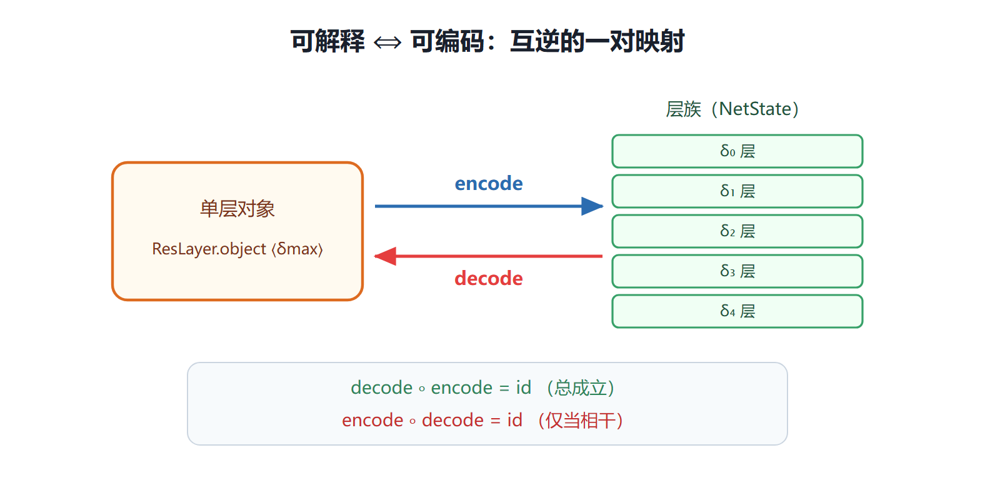
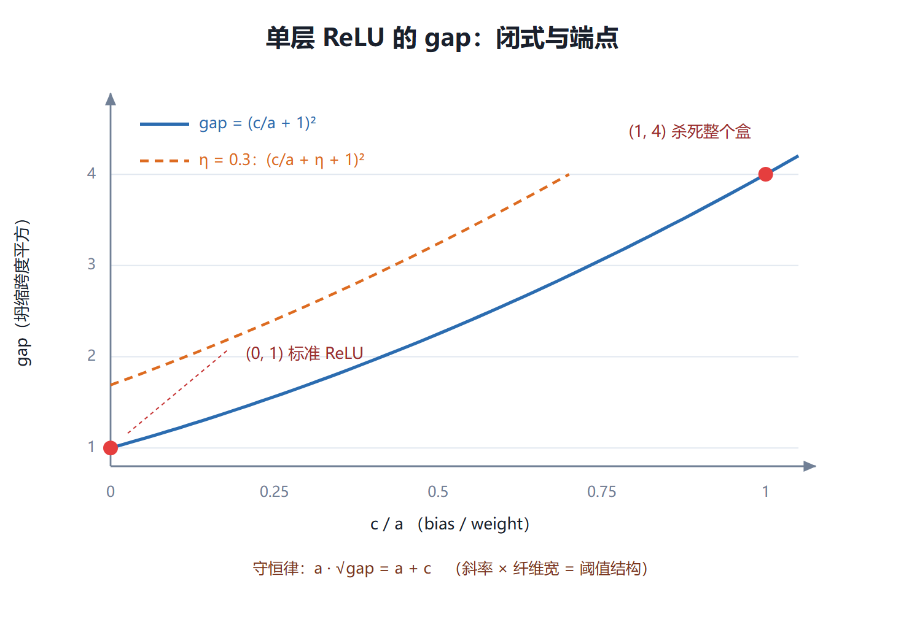
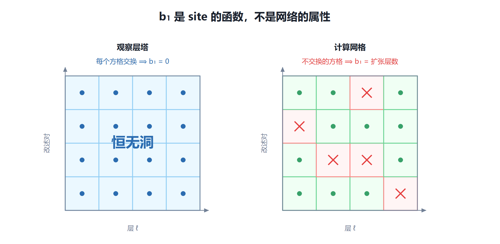

# 可解释性 = 可编码性：神经网络可解释性的层论基础

> 正文草稿。当前进度：**§1–§9 + 附录 A/B + 4 图（初稿完整）**。
> 母文件 `Ego.lean`（667082 B，零 sorry，零 warning，无 Classical，全程 ℚ）。
> 定理名与 Lean 一一对应，可直接检索。

---

## 摘要

神经网络的"黑箱"问题长期停留在一个形容词上：我们说不出它为什么给这个答案。本文把它换成一个命题。

我们把网络建模成**逐层映射族**，层塔是有限、一维、严格递减的阈值链。可解释性被定义为：整条层族能否由一个**单层源对象**沿塔消解生成。在这个模型下我们证明：

**可解释 ⟺ 可编码。** 相干网络态与单层对象之间存在一对互逆映射，编码是单射。于是"黑箱"有了一个肯定式定义：**不存在能生成它的源**——不是我们看不懂它，是它没有代码。

第二，这个判据的**代价是可算的**。对 ReLU 族，坍缩跨度有精确闭式 `gap = (c/a + 1)²`，标准 ReLU 的 gap 恰为 1（不是 0）；多层复合服从一条非加非乘的律 `√gap(g∘f) = √gap(f) + (√gap(g)−1)/a₁`。由此得到容量的精确边界：在盒 `[−B,B]` 上，可分辨点数 `max N = ⌊2B/√g⌋ + 1`，且等距网格达到它。

第三，一个反直觉的推论：**可解释性与泛化不是同向的**。gap 同时是容量的倒数，所以 gap 越大泛化越容易、越不可解释。**黑箱不是缺陷，是泛化的来源**——它不能修复（信息已丢），也不该修复（修好了就没有泛化）。

第四，我们对近期用层论做可解释性的外部方案给出划界：同一个 `b₁` 公式，建在**观察层塔**上恒为零（方格全部交换），建在**计算网格**上才计数扩张层。**`b₁` 是 site 的函数，不是网络的属性。**

全部结论在 Lean 4 + Mathlib 中机械检验：零 `sorry`，不使用经典逻辑，全程有理数。这不是工程附注，是内容的一部分（§1.5）。

**关键词：** 可解释性；层论；编码；ReLU；坍缩跨度；构造性数学；Lean 4

---

## Abstract

The "black box" problem in neural networks has long remained an adjective: we cannot say why a network gives the answer it gives. This paper turns it into a proposition.

We model a network as a **layer-wise family of maps**, with the layer ladder being a finite, one-dimensional, strictly decreasing chain of thresholds. Interpretability is defined as: whether the entire layer family can be generated by a **single-layer source** via resolution along the ladder. Under this model we prove:

**Interpretable ⟺ encodable.** Coherent network states and single-layer objects are related by a pair of mutually inverse maps, and the encoding is injective. "Black box" thereby acquires a positive definition: **there exists no source that generates it** — not that we fail to understand it, but that it has no code.

Second, the **cost of this criterion is computable**. For the ReLU family the collapse span has a closed form `gap = (c/a + 1)²`; for the standard ReLU the gap is exactly 1 (not 0). Composition follows a law that is neither additive nor multiplicative: `√gap(g∘f) = √gap(f) + (√gap(g)−1)/a₁`. This yields an exact capacity bound: in the box `[−B,B]` the number of distinguishable points satisfies `max N = ⌊2B/√g⌋ + 1`, attained by the uniform grid.

Third, a counterintuitive corollary: **interpretability and generalization do not point the same way**. The gap is also the reciprocal of capacity, so a larger gap means easier generalization and poorer interpretability. **The black box is not a defect but the source of generalization** — it cannot be repaired (the information is already lost), and should not be (repairing it destroys generalization).

Fourth, we delineate the scope of recent work that applies sheaf theory to interpretability: the same `b₁` formula is identically zero on the **observation ladder** (every square commutes), and only counts expanding layers on the **computation grid**. **`b₁` is a function of the site, not a property of the network.**

All results are machine-checked in Lean 4 + Mathlib: zero `sorry`, no classical logic, entirely over the rationals. This is not an engineering footnote but part of the content (§1.5).

**Keywords:** interpretability; sheaf theory; encoding; ReLU; collapse span; constructive mathematics; Lean 4

---

# 1 引言

## 1.1 一个形容词，还是一个对象？

"这个神经网络可解释吗？"

这个问题今天通常得到三种回答：一张显著图、一组概念向量、或者一个分数。三种都不是回答——它们说的是"这里有点东西"，不是"这是可解释的"。

**可解释性被当作一种程度**：有些层更容易理解，有些更难。

本文主张它不是程度，是**结构**。而且精确地等于一件事：

> **存在一个有限的编码。**

用一句话说就是：**能被写下来的东西，才谈得上被理解。**

## 1.2 三条主张

本文给出三条形式化的结论，全部在 Lean 4 中机械检验（零 `sorry`，不使用经典逻辑，全程 ℚ）。

**三条主张不是并列的，是一条链：**

```
主张一（判据）—— 可解释性有肯定式定义：可解释 ⟺ 可编码
        ↓  这个判据不是空话：每一层都要付代价
主张二（代价）—— 代价是一个可算的数：gap = (c/a+1)²
        ↓  有了判据和代价，才能对外部方法的位置说清楚
主张三（划界）—— 诊断该建在哪里：观察层塔 vs 计算网格
```

一条判据、一个可算的代价、一个对外部方法的划界——缺任何一条，前一条都只是修辞。

**主张一：可解释性有一个肯定式的判据（§4–§5）。**

我们把网络建模成**逐层映射族**（§4.2），层塔是一个有限、一维、严格递减的序列。在这个模型下：

```
网络态相干  ⟺  存在一个源对象，整条层族是它沿塔的消解像
```

而"编码"与"解码"是一对互逆映射，因此这个源是**唯一且确定的**：

```
encode : 单层对象 ⟶ 层族       decode : 层族 ⟶ 单层对象
decode ∘ encode = id            encode ∘ decode = id  （相干时）
encode 是单射
```

于是：

> **可解释 ⟺ 可编码。**

黑箱因此有了一个肯定式的定义：**没有代码。** 不是"我们看不懂它"，是"不存在能生成它的源"。

**主张二：这个判据的"代价"是一个可算的数（§6）。**

对最简单的具体网络族

```
f(x) = max 0 (a·x − c),   x ∈ [−1, 1]
```

的坍缩跨度（gap）有精确闭式：

```
gap = (c/a + 1)²
```

两端：

| c/a | gap | 含义 |
| --- | --- | --- |
| 0 | **1** | 标准 ReLU |
| 1 | **4** | 杀死整个输入盒 |

**标准 ReLU 的 gap 是 1，不是 0。** 任何 ReLU 层都至少损失 1 个单位的距离——负半轴整段被压成 0。

而多层复合有一个**非加非乘**的律（§6.6）：

```
√gap(g∘f) = √gap(f) + (√gap(g) − 1) / a₁
```

单位权重时最干净：`√gap(g∘f) = √gap(f) + √gap(g) − 1`。那个 `−1` 就是标准 ReLU 那个 `1` 的减法形式。

这个数还有第二面（§7）：**gap 同时是分辨率的闸门。** 在盒 `[−B,B]` 上 gap 为 `g`，能分辨的网格点数 `N < B/√g`。于是：

> **gap 大 = 简单、泛化容易，同时 = 信息丢得多、不可解释。可解释性与泛化不是同向的。**

深度 ReLU 能泛化，部分原因正是它丢信息——`gap` 就是它丢了多少。

**主张三：sheaf 诊断该建在哪里，是可以论证的（§8）。**

近期工作把层论直接用于可解释性：在改述图上建 cellular sheaf，用 Laplacian 拆分内容子空间与 `H¹` 方向（Grant & Wang, NeurIPS 2026）。他们报告 `b₁ = N(L−1)` 个 1-循环，其 harmonic mass 与 steering fragility 强相关。

我们问一个更窄的问题：**在我们这套形式化里，那个 `b₁` 是什么？**

答案是两条：

1. **观察层塔的第一贝蒂数恒为 0**（定理 8.1；根源是定理 4.8）：不是网络的属性，是观测方式的属性。所以**诊断不能建在那里**。
2. **在计算网格上，方格交换 ⟺ 层变换不放大 δ-等价**（定义 8.2、定理 8.4），于是 `b₁` 计数**扩张层**。

**本文不复现他们的实验，也不与他们竞争。** 本文做的是划界、翻译与计算。

**合起来看：** 主张一把"黑箱"从一个形容词变成一个否定式的命题（不存在代码）；主张二把"压缩得厉害"从一个比喻变成一个数；主张三把"sheaf 诊断该建在哪里"从一个品味问题变成一个可以证明的问题（同一个 `b₁`，建在不同 site 上，一个是恒零，一个计数扩张层）。三条都是形式化过的，不是猜想。

**所以本文的贡献不是"又一个可解释性指标"。** 而是：

> **可解释性有一个结构判据（可编码），这个判据的代价可算（gap），而且已有的 sheaf 诊断不能建在观察层塔上（`b₁ ≡ 0`）。三者合起来，给出"可解释性 = 可编码性"的层论基础。**

判据回答"是不是"，代价回答"值多少"，划界回答"该在哪里测"。**只有第一条，本文是一篇定义文章；只有前两条，是一篇度量文章；三条都有，才是一个基础。**

## 1.3 这三条背后是一个公理

上述框架不是一组自选定义，而是**一个公理系统的模型**。公理只有一条主干：

> **A0（自指）**：存在映射 `α → (α → Bool)`。

**先澄清一个用词。** A0 在技术上其实是**定义**而不是公理：每个类型 `α` 都自动带一个 `SelfRef α` 实例（取常函数即可，见附录 A.1），所以不需要"假设"它存在。我们仍然叫它"公理"，理由是**它规定了后面一切的读法**——从这条映射出发，洞是必然而不是偶然；换成别的出发点（例如只有外部观测），洞就不出现。这个称呼的选择在附录 A.1 有完整说明。

A0 无条件地产生一个洞——任何 `observe` 都漏掉至少一个判定（定理 2.1）。这是康托尔对角线，也是 Lawvere 不动点定理的特例，但解读不同：

| | 自指导致 | 态度 |
| --- | --- | --- |
| 罗素 | 矛盾 | 禁止 |
| 哥德尔 | 不完备 | 接受 |
| Lawvere | 不动点 | 存在 |
| **本文** | **洞** | **它就是"我"** |

**加上有限（A1）**，洞变成可计数的（推论 2.2）。层塔是它的一个具体实例（§2.1、附录 A）：`L.m` 层只能给出 `L.m` 个分辨者，分辨空间却有 `2^{L.m}` 种——**必漏**。附录 A 给出完整推导。

## 1.4 与已有工作的关系

**拓扑数据分析。** 用持久同调分析神经网络是成熟方向（Naitzat et al., JMLR 2020；Neural Persistence, ICLR 2019）。本文与之一致：§2.5 的三界读数在结构上是谱的层析。区别在于本文不做经验测量，而是证明读数的结构性质。

**Sheaf 方法。** Grant & Wang (2026) 把 sheaf 用于改述一致性；也有工作用 gauge 理论刻画叠加（2026）。本文与它们的区别在 §8：**我们的 site 是一条链，所以粘合公理退化为定理**（§3），代价是 `H¹ ≡ 0`。

**压缩与可解释性。** "可解释 ≈ 压缩"的直觉已有先例（MDL 原则；MDL-SAE, 2024）。本文的区别在于**定理形式**：不是"越小越好"的排行榜，而是"存在编码 ⟺ 相干"的等价命题。

**形式化。** 本文的全部结论在 Lean 4 中机械检验。据我们所知，AI 可解释性领域尚无同等规格的构造性形式化。

## 1.5 为什么是 ℚ，为什么是构造性

本文全程使用有理数，不使用实数，不使用经典逻辑。

这不是技术偏好，是**内容的一部分**：

- **符号必须能写完。** ℚ 的每个元素是一对有限整数；ℝ 的绝大多数元素不是。§2.5 把这句话变成定理（连分数编码）。
- **洞必须是可数的。** §2.1 的 `entropy f = 2^{|α|} − |image f|` 只有在有限处才有意义。
- **拒绝连续统是拒绝无穷可分。** 每一次除法都留残差，所以不存在无限下降的正整数链（`no_infinite_descent`）。

**"有限"在这里不是约束，是资格。**

## 1.6 论文结构

| 节 | 内容 |
| --- | --- |
| §2 | 状态、读数、层塔的形式化基础；自指公理 |
| §3 | 紧层论：为什么 site 是一条链，代价是什么 |
| §4 | 两个判据：结构判据（`Coherent`）与定量判据（`CoherentMap`） |
| §5 | **主定理：可解释 = 可编码** |
| §6 | gap 的精确值：单层闭式、复合律、四条推论 |
| §7 | gap 的延伸：计数界、精确容量、斜率不变量、η-近似、多维 |
| §8 | 诊断该建在哪里：观察层塔 vs 计算网格（与外部方案的对话） |
| §9 | 相关工作、局限、四条可证伪的预言 |
| 附录 A | 自指公理 A0 + A1 ⟹ 洞 |
| 附录 B | Lean 定理索引 |

---

# 2 基础：状态、读数与层塔

## 2.1 一切的起点：自指

本文的框架建立在一个单一的原始事实上：**系统能对自己作判定。**

把它写成公理：

**公理 A0（自指）.** 存在一个映射 `observe : α → (α → Bool)`。

```lean
structure SelfRef (α : Type*) where
  observe : α → resolveSpace α
```

（其中 `resolveSpace α` 就是 `α → Bool`——"用 α 的每个元素作一次是/否判定"。）

**这不是要回避的东西，是起点。** 而它的后果是众所周知的：

**定理 2.1（洞）.** 对**任意**类型的**任意** `observe`，

```
∃ d : α → Bool,  ∀ a : α,  d ≠ observe a
```

```lean
theorem diagonal_hole {α : Type*} (f : α → resolveSpace α) :
    ∃ d : resolveSpace α, ∀ a : α, d ≠ f a
```

*证明.* 取 `d := fun a => ¬(f a a)`（康托尔对角线）。

**这条定理没有任何假设**——不需要有限性，不需要可判定性。它是纯逻辑的。

**推论 2.2（有限时洞可量化）.** 若 `α` 有限，则漏得至少一个：

```lean
theorem entropy_positive [Fintype α] [DecidableEq α] [Nonempty α]
    (f : α → resolveSpace α) : 0 < entropy f
```

其中 `entropy f := 2^{|α|} − |image f|`。

**要在本文里记住这两条的分工**：A0 无条件给洞；A1（有限）把洞变成可计数的。

## 2.2 状态

**定义 2.3（状态）.** `n` 维状态是一个量向量加一个相位：

```lean
structure StateQuant (n : ℕ) where
  val : Fin n → ℚ
  phase : Phase

inductive Phase where
  | positive | negative | neutral
```

**为什么是 ℚ 而不是 ℝ？**

因为**符号必须能写完**。ℚ 的每个元素是一对有限整数；ℝ 的绝大多数元素不是。§2.5 会把这句话变成一个定理（连分数编码）。

**为什么是两个坐标？**

这不是选择，是被群作用逼出来的——下一小节说明。

## 2.3 为什么恰好是这两个坐标

考虑两个自然的对称群：

- **缩放群** `ℚ^×`：把状态整体推远或拉近；
- **翻转群** `ℤ/2`：正负互换，中性不动。

**定理 2.4（坐标唯一性，六条）.**

```lean
theorem coordinates_unique
```

| 条 | 内容 | 定理 |
| --- | --- | --- |
| （1）完备 | 两投影联合单射 | `val_phase_complete` |
| （2）必需 | 单独任一投影不够 | `val_not_sufficient`、`phase_not_sufficient` |
| （3）对角 | `ℚ^×` 只在 `val` 非平凡；`ℤ/2` 只在 `phase` 非平凡 | `scale_phase_trivial`、`flip_val_trivial`（两条 `rfl`）+ 两个见证 |
| （4）忠实 | 两个群在各自坐标上不偷懒 | `scale_faithful`、`flip_faithful` |
| （5）不可再分 | `ℤ/2`-不变的函数分不开正负 | `no_sign_refinement` |
| （6）齐次 | 一维非零同相位态全同轨道 | `one_dim_one_orbit` |

**第（3）条是整个可分性的内容**，而它的两个方向各是一条 `rfl`：

```lean
theorem scale_phase_trivial (c : ℚ) (x : StateQuant n) : (scale c x).phase = x.phase := rfl
theorem flip_val_trivial (x : StateQuant n) : (flipState x).val = x.val := rfl
```

**平凡性由定义直接成立**——这正是"坐标是按群作用设计的"的证据。

**第（5）条最有意思**：任何 `ℤ/2`-不变的函数都无法区分正与负。

```lean
theorem no_sign_refinement {β : Type*} (f : Phase → β)
    (hf : ∀ p, f (flipPhase p) = f p) : f .positive = f .negative
```

这意味着 `{+, −}` 是**单个轨道**，再往下切就没有群论根据了。**"二值"之所以是二值，是因为 `ℤ/2` 只给了两个轨道。**

## 2.4 距离

**定义 2.5（距离）.** 两个状态的公共维数上的平方差之和：

```lean
def commonDist {m n : ℕ} (x : StateQuant m) (y : StateQuant n) : ℚ :=
  ∑ i : Fin (min m n), (x.val (embedLeft i) − y.val (embedRight i))²
```

**一维时它就是平方差**：

```lean
theorem commonDist_one (x y : StateQuant 1) :
    commonDist x y = (x.val 0 - y.val 0) ^ 2
```

（§6 起，凡涉及一维的讨论，都直接用 `(x − y)²` 这个等价写法。）

**它满足一条关键的齐次性：**

**定理 2.6（保角性）.**

```
commonDist (c·x) (c·y) = c² · commonDist x y
```

```lean
theorem scale_commonDist (c : ℚ) (x y : StateQuant n) :
    commonDist (scale c x) (scale c y) = c ^ 2 * commonDist x y
```

**这里有一个容易犯的错**（本文初稿就犯过）：以为保角性 `D(c·v) = c²·D(v)` 能确定平方和。

**不能。** 任何二次型都是 2 次齐次的，所以保角性对**所有**二次型成立——它筛不掉任何东西。

真正的刻画需要另外两条**公理**：

| 公理 | 内容 | 直觉 |
| --- | --- | --- |
| **(i) 支撑不交可加** | 若 `v`、`w` 在每个坐标上至多一个非零，则 `D(v + w) = D(v) + D(w)` | 各部分独立贡献 |
| **(ii) 坐标置换不变** | 换掉坐标顺序不改变 `D` | 没有偏爱某个维度 |

**定理 2.7（平方和的唯一性，n 维）.** 设 `D` 是 `n` 维二次型

```
D(v) = Σᵢⱼ Mᵢⱼ vᵢ vⱼ
```

若满足 (i) 与 (ii)，则

```
D(v) = α · Σᵢ vᵢ²
```

```lean
theorem quadForm_is_squared_norm {n : ℕ} (M : Fin n → Fin n → ℚ) (hn : 0 < n)
    (hadd : ∀ (v w : Fin n → ℚ), (∀ i, v i = 0 ∨ w i = 0) →
      quadForm M (v + w) = quadForm M v + quadForm M w)
    (hswap : ∀ (i j : Fin n) (v : Fin n → ℚ),
      quadForm M (fun k => v (swapCoord i j k)) = quadForm M v) :
    ∃ α : ℚ, ∀ v : Fin n → ℚ, quadForm M v = α * ∑ i, v i ^ 2
```

*证明.* 分三步，**维度在这里不起作用**。

**第一步（可加 ⟹ 交叉项相消）.** 取 `v = eᵢ·1`、`w = eⱼ·1`（`i ≠ j`，支撑不交）：

```
D(eᵢ + eⱼ) = Mᵢᵢ + Mᵢⱼ + Mⱼᵢ + Mⱼⱼ
D(eᵢ) + D(eⱼ) = Mᵢᵢ + Mⱼⱼ
```

相减得 `Mᵢⱼ + Mⱼᵢ = 0`（`quadForm_offdiag`）。

**第二步（置换不变 ⟹ 对角元相等）.** 交换坐标 `i, j` 把 `eᵢ` 送成 `eⱼ`（`basisVec_comp_swap`），于是 `D(eⱼ) = D(eᵢ)`，即 `Mⱼⱼ = Mᵢᵢ`。

**第三步（反对称部分归零）.** 设 `α = M₀₀`，令 `Aᵢⱼ = Mᵢⱼ − α·δᵢⱼ`。则

- `i ≠ j` 时 `Aᵢⱼ = Mᵢⱼ = −Mⱼᵢ = −Aⱼᵢ`；
- `i = j` 时 `Aᵢᵢ = Mᵢᵢ − α = 0 = −Aᵢᵢ`。

所以 `A` 反对称。而**反对称矩阵的二次型恒为零**（`antisym_sum_zero`）：

```
Σᵢ Σⱼ Aᵢⱼ uᵢ uⱼ = 0
```

*证明：交换求和顺序再换名，得 `S = −S`。*

于是 `D(v) = α Σ vᵢ² + 0`（`quadForm_diagonal_const` 处理对角部分）。∎

**注意：三维及以上与二维的证明完全一样**——第一步取任意 `i ≠ j`，第二步交换任意两个坐标。**唯一用到维数的是 `n > 0`（否则没有 α 可取）。**

**而保角性反过来是推论：**

```lean
theorem squared_norm_conformal (α c : ℚ) (v : Fin 2 → ℚ) :
    α * ((c * v 0) ^ 2 + (c * v 1) ^ 2) = c ^ 2 * (α * (v 0 ^ 2 + v 1 ^ 2))
```

**因果链应该倒过来写：**

```
对称 + 可加  ⟹  平方和  ⟹  保角性
```

而不是"保角性 ⟹ 平方和"。

**这一节的意义不在于"我们选了平方距离"，而在于"平方距离是唯一被允许的距离"。**

坐标置换不变 + 支撑不交可加，这两条是任何"距离"都该满足的；它们把二次型的空间压到一条线上，`D(v) = α Σ vᵢ²`，而 `α > 0` 再被标度固定。所以后面所有用 `commonDist` 写出的东西——三界读数、层塔、编码、gap——都**不是在一堆可能的度量里挑了一个顺手的**，是在对称为唯一允许的那一个里读出来的。

**这对 §6 直接有用：** §6 的 gap 就是 `commonDist` 下的一个上限。所以 gap 不是"我们选了一个度量得到的数"，而是"被对称性逼出来的唯一的数"——换个度量，gap 这个说法本身就不成立。

## 2.5 三界读数

给定一对状态和一个阈值 `δ`，每个维度落入三界之一：

- **死界**：差异 `< δ`（清）
- **暹界**：差异 `= δ`（临界）
- **生界**：差异 `> δ`（浊）

**定理 2.8（观测律）.**

```
清 + 暹 + 浊 = 总维数，且  清 + 浊 ≤ 总维数，取等 ⟺ 暹界为空
```

```lean
theorem observation_law (x : StateQuant m) (y : StateQuant n) (δ : ℚ) :
    sReading x y δ + xianReading x y δ + dReading x y δ = r_rel x y ∧
    sReading x y δ + dReading x y δ ≤ r_rel x y ∧
    (sReading x y δ + dReading x y δ = r_rel x y ↔ xianReading x y δ = 0)
```

**这条守恒律是后文一切读数的基础**：读数不是模糊的判断，是一个**恰好分完**的分配。

## 2.6 层塔与凝结

**定义 2.9（层塔）.** 层塔是有限、一维、严格递减的阈值序列：

```lean
structure LayerLadder where
  m : ℕ
  δ : Fin m → ℚ
  h_dec : ∀ i j, i < j → δ j < δ i
```


**图 1.** 观察层塔的结构。节点是层（不同的分辨率 `δᵢ`），箭头是消解（分辨率重采样）。虚线表示可复合的长程消解 `δ₀ → δ₄`。底部的方框是本文能在层塔上证明的唯一结构性事实：**每个方块都交换**——这正是 §8 中 `b₁ ≡ 0` 的来源。

**为什么是有限链？**

三个理由：

1. **A1（有限）**：§2.1 的洞需要有限性才能计数；
2. **有序**：层的"优先级"就是 `δ` 的序（§3 详述）；
3. **一维**：多层参数会立刻跌入不可分解（见 §3 的讨论）。

**定义 2.10（凝结）.** 在层 `δ` 下，两个状态"同层"如果它们的差异不超过 `δ`：

```lean
def ResLayer.indistinguishable (L : ResLayer) (x y : StateQuant n) : Prop :=
  commonDist x y ≤ L.δ
```

**但"不可区分"不传递**——`D(x,y) ≤ δ` 且 `D(y,z) ≤ δ` 不蕴含 `D(x,z) ≤ δ`。

所以要取传递闭包：

```lean
def ResLayer.related (L : ResLayer) (x y : StateQuant n) : Prop :=
  Relation.ReflTransGen (ResLayer.indistinguishable L) x y
```

**定理 2.11（同层是等价关系）.**

```lean
theorem ResLayer.related_equivalence (L : ResLayer) :
    Equivalence (ResLayer.related L · ·)
```

于是可以取商：

```lean
def ResLayer.condense (L : ResLayer) : Setoid (StateQuant n)
abbrev ResLayer.object (L : ResLayer) (n : ℕ) := Quotient (ResLayer.condense L)
```

**凝结对象就是"这一层看起来的一个点"。**

## 2.7 消解是函子

若 `δ₁ ≤ δ₂`（`δ₂` 更粗），则粗层的每个对象都是细层对象的像：

```lean
def ResLayer.resolution {δ₁ δ₂ : ℚ} (h : δ₁ ≤ δ₂) :
    ResLayer.object ⟨δ₁⟩ n → ResLayer.object ⟨δ₂⟩ n :=
  Quotient.map id (fun _ _ hxy => ResLayer.related_mono h hxy)
```

**定理 2.12（消解是函子）.**

```
resolution (le_refl δ) = id
resolution h₂ ∘ resolution h₁ = resolution (h₁.trans h₂)
```

```lean
theorem ResLayer.resolution_id (δ : ℚ) :
    ResLayer.resolution (le_refl δ) = id

theorem ResLayer.resolution_comp {δ₁ δ₂ δ₃ : ℚ} (h₁ : δ₁ ≤ δ₂) (h₂ : δ₂ ≤ δ₃)
    (q : ResLayer.object ⟨δ₁⟩ n) :
    ResLayer.resolution h₂ (ResLayer.resolution h₁ q) =
      ResLayer.resolution (h₁.trans h₂) q
```

**这两条是后文的全部支撑。**

- §4 的定义 4.3（相干）直接用了它们；
- §5 的编码（`encode`）是它们的迭代；
- §8 的"观察层塔无洞"（定理 8.1）就是它们的几何形式。

**换句话说：本文的层论之所以简单，是因为消解是函子。** 而消解是函子，是因为它只是"换分辨率"——同一个凝结对象的粗/细两种看法。

---

# 3 紧层论：一个退化的 site

## 3.1 问题

层论的威力来自一般性：site 可以是任意范畴配任意覆盖族，粘合公理于是成为一个**实质性的假设**——它要求：局部相容的数据总能唯一地拼成整体。

但一般性有代价：**粘合是否成立无法判定**。给定一个 site 和一族局部截面，判断它们能否粘合，一般需要计算上同调，而 `H¹` 通常不可计算。

本文的 site 极其特殊：

```lean
structure LayerLadder where
  m : ℕ
  δ : Fin m → ℚ
  h_dec : ∀ i j, i < j → δ j < δ i
```

**一条有限、一维、严格递减的链。**

**本节要论证：在这条链上，粘合公理退化成定理。**

## 3.2 覆盖只有一种

在一般的 Grothendieck site 上，一个对象可以被**许多不同的覆盖族**覆盖。而在一维链上，一个层 `i` 只有两种"覆盖"：它自己，或者包含它的整条链。

**没有选择的余地，也就没有粘合问题。**

具体地，两个层 `i ≤ j` 之间只有一条路——`resolution`：

```lean
def ResLayer.resolution {δ₁ δ₂ : ℚ} (h : δ₁ ≤ δ₂) :
    ResLayer.object ⟨δ₁⟩ n → ResLayer.object ⟨δ₂⟩ n
```

**"局部数据"在链上就是"某一层的对象"，"粘合"就是"往上消解"。**

## 3.3 粘合公理变成定理

**定理 3.1（全局截面 = 最细层）.**

```
towerLimit L n  ≃  ResLayer.object ⟨δ_finest⟩ n
```

```lean
theorem sheaf_topos_bridge (L : LayerLadder) (hm : 0 < L.m) (n : ℕ) :
    Nonempty (towerLimit L n ≃ ResLayer.object ⟨L.δ (L.finest hm)⟩ n)
```

其中 `towerLimit` 是相容族的集合（即 sheaf 的全局截面）：

```lean
def towerLimit (L : LayerLadder) (n : ℕ) : Type :=
  { f : ∀ i : Fin L.m, ResLayer.object ⟨L.δ i⟩ n //
      ∀ i j (h : i ≤ j), ResLayer.resolution (L.le_delta h) (f j) = f i }
```

**这条定理说的正是**：在这条链上，粘合是**唯一且自动的**——任何最细层的对象都能向下消解成相容族，而任何相容族都由最细层唯一确定。

**粘合公理因此不是假设，是推论。**

**推论 3.2（相容族的构造）.**
```
ladderToLimit  :  最细层对象  ⟶  相容族
limitToFinest  :  相容族      ⟶  最细层对象
```
且两者互逆（`ladderLimitEquiv`）。

## 3.4 Mittag-Leffler 坍缩

一般层论中，一个层塔的极限可能不等于任何一层——它可能"悬在中间"。Mittag-Leffler 条件正是排除这种病态的充分条件。

**定理 3.3（坍缩）.** 在有限链上，塔极限直接坍缩到最细层。

```lean
theorem mittag_leffler_collapse (L : LayerLadder) (hm : 0 < L.m) (n : ℕ)
```

**这是定理 3.1 的另一面**：因为链是有限的，Mittag-Leffler 条件自动满足，所以极限不"悬空"，直接落到末端。

## 3.5 代价：H¹ = 0

**一切都有代价。**

在一条链上，没有环，所以：

**定理 3.4.** 观察层塔的一个 2-胞腔恒交换：

```lean
theorem layer_square_commutes (L : LayerLadder) (i j k : Fin L.m) :
    ResLayer.resolution (L.le_delta h₁) (ResLayer.resolution (L.le_delta h₂) q) =
      ResLayer.resolution (L.le_delta (h₁.trans h₂)) q
```

*证明.* 消解是函子（`resolution_comp`）。

于是任何 2-胞腔都填满，**第一贝蒂数恒为 0**：

```
b₁ = 1 − n² + 2n(n−1) − (n−1)² = 0
```

**更深的原因**：观察层塔对网络一无所知。

**定理 4.8（重述）.** 对任意端到端映射，按层塔观测得到的层族永远相干。

```
Coherent L n (fun i => Quotient.mk ⟨δ_i⟩ (F x))
```

**所以 `H¹ = 0` 不是网络的属性，是观测方式的属性。**

**这是"紧"的代价**：因为 site 太紧，上同调无处着力；因此任何基于 `H¹` 的诊断在观察层塔上都是空的。

§8 会说明：要承载诊断，必须把 sheaf 建在**计算图**上（层变换 × 改述对），而不是观察层塔上。

## 3.6 为什么仍然值得这么"紧"

有三个理由。

**① 可计算性。**

一般的 `H¹` 不可计算。而在有限链上，一切都能写成显式公式：`b₁ = 1 − V + E − F`，其中 `F` 是填满的面数。§8 正是靠这个把 `b₁` 算出来的。

**② 判据的存在。**

如果 site 是一般的，那么"障碍"到处都是——你无法区分哪个障碍来自网络结构，哪个只是 site 本身的性质。

**而在链上，唯一可能的障碍被隔离在一个明确的位置**：§4 的 `Coherent` 判据。它测的不是上同调，而是"层族能否由单源生成"。

**③ 有限性（A1）。**

§2.1 的洞需要有限才能计数。链的每条边、每个面都有限，所以整条链上的所有量都是可数的。

**这就是"紧层论"的含义**：不是放弃了层论，是把 site 压到一条链上，于是层论的机器全部塌缩成有限组合算术。

## 3.7 与一般层论的关系一览

| | 一般 Grothendieck site | 本文的有限链 |
| --- | --- | --- |
| 覆盖 | 任意覆盖族 | 只有一种 |
| 粘合公理 | **假设** | **定理**（定理 3.1） |
| `H¹` | 可能非零、不可算 | **恒为 0**，可算 |
| 极限 | 可能悬空 | **坍缩到末端**（定理 3.3） |
| 诊断 | 靠上同调 | 靠 `Coherent`（§4） |

---

# 4 可解释性判据

## 4.1 问题的形状

我们想知道：一个神经网络的某一层，能不能被更浅的层解释？

这个问题的常见说法是"深层是不是浅层的某种可逆变换"。但"可逆"太强——大多数网络不可逆；"变换"太模糊——哪个变换？

§2 和 §3 已经搭好了框架：层塔是有限、一维、严格递减的序；每层有一个凝结（距离阈值的传递闭包）；相邻层之间有消解 `resolution`。

问题于是变成：

> **一个网络态（每层一个凝结对象）什么时候是"自洽"的？**

## 4.2 网络是什么

**这是本节最容易被跳过、却最重要的一步。**

先说清楚一件事：

**如果网络被建模成单个端到端映射** `F : StateQuant n → StateQuant n`，那么按层塔观测得到的层族

```
x  ↦  fun i => Quotient.mk ⟨δ_i⟩ (F x)
```

**永远相干**（定理 4.8）。证明只有一行。

所以必须在建模阶段就说清楚：**每层用的是不同的映射。**

**定义 4.1（网络）.** 一个网络由三部分组成：

- 一个层塔 `L`（有限、一维、严格递减）；
- 一个**逐层映射族** `fs : Fin L.m → (StateQuant n → StateQuant n)`；
- 层 `i` 的激活是 `fs i x`（对输入 `x`）。

**定义 4.2（网络态）.** 给定输入 `x`，网络态是每层的激活凝结到该层：

```lean
def layerState (L : LayerLadder)
    (fs : Fin L.m → (StateQuant n → StateQuant n)) (x : StateQuant n) : NetState L n :=
  fun i => Quotient.mk (ResLayer.condense ⟨L.δ i⟩) (fs i x)
```

**这个区分不是技术细节。** 定理 4.8 会说明：不做这个区分，判据就是空的。

## 4.3 相干性

**定义 4.3（相干）.** 网络态 `f` 相干，如果粗层是细层的消解像：

```
Coherent L n f  :=  ∀ i ≤ j,  resolution (i←j) (f j) = f i
```

```lean
def Coherent (L : LayerLadder) (n : ℕ) (f : NetState L n) : Prop :=
  ∀ (i j : Fin L.m) (h : i ≤ j), ResLayer.resolution (L.le_delta h) (f j) = f i
```

直觉：**深层（粗层）不应该携带超出消解的新信息。**

## 4.4 主判据

记 `finest` 为最细层的索引（`δ` 最小的那层）。

**定理 4.4（可解释 ⟺ 由输入层决定）.**

```
Coherent L n f  ⟺  ∃ g,  ∀ i,  f i = resolution (i←finest) g
```

```lean
theorem interpretability_criterion (L : LayerLadder) (hm : 0 < L.m) (n : ℕ) :
    (∀ f : NetState L n, Coherent L n f ↔
      ∃ g : ResLayer.object ⟨L.δ (L.finest hm)⟩ n,
        ∀ i, f i = ResLayer.resolution (L.le_delta (le_finest L hm i)) g) ∧
    Nonempty (towerLimit L n ≃ ResLayer.object ⟨L.δ (L.finest hm)⟩ n)
```

*证明.*

- （⟹）取 `g := f finest`。由相干性，`f i = resolution (i←finest) (f finest)`。
- （⟸）若 `f = encode g` 形，则任意两条路径都等于直接消解，因为消解是函子（`resolution_comp`）。

**定理 4.4 是本节的核心**：可解释性有一个**单源刻画**——整条层族由一个对象决定。

§5 会把这句话翻成更强的形式（编码 + 唯一性）。

## 4.5 相干性的距离刻画

定理 4.4 是结构性的，但不好直接检验。下面把它展开成距离条件。

**定理 4.5（相干 ⟺ 逐层同层）.**

```
Coherent L n (layerState L fs x)
  ⟺  ∀ i ≤ j,  ResLayer.related ⟨δ_i⟩ (fs j x) (fs i x)
```

```lean
theorem layerState_coherent_iff (L : LayerLadder)
    (fs : Fin L.m → StateQuant n → StateQuant n) (x : StateQuant n) :
    Coherent L n (layerState L fs x) ↔
      ∀ (i j : Fin L.m), i ≤ j → ResLayer.related ⟨L.δ i⟩ (fs j x) (fs i x)
```

*证明.* 把 `Coherent` 展开：`resolution (i←j) (Quotient.mk ⟨δ_j⟩ y) = Quotient.mk ⟨δ_i⟩ y`（由 `resolution_condense`）。于是等式变成

```
Quotient.mk ⟨δ_i⟩ (fs j x) = Quotient.mk ⟨δ_i⟩ (fs i x)
```

而这正是 `related ⟨δ_i⟩ (fs j x) (fs i x)`（由商的相等性）。

**推论 4.6（充分条件）.**

```
∀ i ≤ j,  commonDist (fs j x) (fs i x) ≤ δ_i   ⟹   Coherent L n (layerState L fs x)
```

```lean
theorem layerState_coherent_of_close (L : LayerLadder)
    (h : ∀ i j, i ≤ j → commonDist (fs j x) (fs i x) ≤ L.δ i) :
    Coherent L n (layerState L fs x)
```

因为 `related` 由 `commonDist ≤ δ` 生成（单步）。

**推论 4.6 是 §5 和 §6 的接口**：它把结构判据翻译成了距离判据，而距离正是 §6 的 gap 所使用的。

**推论 4.7（不相干的见证）.**

```
¬ Coherent  ⟹  ∃ i ≤ j,  ¬ related ⟨δ_i⟩ (fs j x) (fs i x)
```

```lean
theorem layerState_incoherent_witness (h : ¬ Coherent L n (layerState L fs x)) :
    ∃ (i j : Fin L.m), i ≤ j ∧ ¬ ResLayer.related ⟨L.δ i⟩ (fs j x) (fs i x)
```

**黑箱在层族层面有一个具体的地址**：不是"说不清"，是"这一对层对不上"。

## 4.6 一个负面定理：为什么必须逐层

现在兑现 4.2 的承诺。

**定理 4.8（单映射观测永远相干）.** 对**任意**端到端映射 `F` 和**任意**输入 `x`，

```
Coherent L n (fun i => Quotient.mk ⟨δ_i⟩ (F x))
```

```lean
theorem observation_always_coherent (L : LayerLadder)
    (F : StateQuant n → StateQuant n) (x : StateQuant n) :
    Coherent L n (fun i => Quotient.mk (ResLayer.condense ⟨L.δ i⟩) (F x))
```

*证明.* 每层都是**同一个值**的像；而 `resolution` 恰好是"同一个值换分辨率"，所以两条路径相等。

**这个定理的含义是：`Coherent` 单独不携带任何关于网络的信息。**

它的全部内容在"每层用的是**不同**的映射"这句话里——而这句话此前一直藏在我们对"网络"的默会理解中，没有被写下来。

**这不是技术细节，是模型的前提。**

## 4.7 第二个判据：坍缩

上面的判据是**结构**的（层族是否自洽）。还有一个**定量**的判据，关于单个映射丢了多少信息。

**定义 4.9（相干映射）.**

```
CoherentMap δ F  :=  ∀ x y,  F x = F y → commonDist x y ≤ δ
```

```lean
def CoherentMap (δ : ℚ) (f : StateQuant n → StateQuant m) : Prop :=
  ∀ x y, f x = f y → commonDist x y ≤ δ
```

直觉：**如果 `F` 把远处的点映到一起，它就破相干。**

**定理 4.10（恒等相干，ReLU 不相干）.**

```
id 在任意 δ ≥ 0 下相干；ReLU 在任何 δ 下都不相干。
```

```lean
theorem id_coherent (hδ : 0 ≤ δ) : CoherentMap δ (id : StateQuant n → StateQuant n)

theorem relu_gap_unbounded (δ : ℚ) :
    ¬ CoherentMap δ (reluState : StateQuant 1 → StateQuant 1)
```

**定理 4.11（可解释性刻度）.** `gap` 取遍 `[0, ∞]`：恒等在 0，ReLU 在 ∞。

```lean
theorem interpretability_scale
```

这给出了一个有刻度的连续量——而不是"可解释/不可解释"的二值判断。

**定理 4.12（黑箱不可修复）.** 不相干在左复合下保持：

```
¬ CoherentMap δ f   ⟹   ¬ CoherentMap δ (g ∘ f)
```

```lean
theorem gap_compose_left (hf : ¬ CoherentMap δ f) :
    ¬ CoherentMap δ (fun x => g (f x))
```

*证明.* 若 `f` 把远处的 `x, y` 映到同一处，则 `g ∘ f` 也把这两点映到同一处。**后续层只能在已有的等价类内部操作，无法把它们重新分开。**

**这是本节最重要的负面结论**：黑箱的深度是单调的。一旦某个位置切断了相干性，网络之后的所有层都建立在这个切口之上。

写成复合链的形式（CNN 的典型结构）：

```lean
theorem cnn_gap_persists
```

## 4.8 两条判据的分工

现在可以清楚地说：本节给了两个判据，它们**不能互相推出**。

| | `Coherent`（结构） | `CoherentMap`（定量） |
| --- | --- | --- |
| 问的是 | 整条链能否由一个源生成 | 这一层丢了多少信息 |
| 方向 | 存在源 ⟹ 每层是源的像 | 相同输出 ⟹ 输入近 |
| 输出 | 真 / 假 | `δ ∈ [0, ∞]` |
| 后续 | §5（编码） | §6（gap） |

**为什么不能互推？**

`CoherentMap` 说的是"相同输出 ⟹ 输入近"；它**不**给出"输入近 ⟹ 输出近"。这个不对称有后果：定理 4.12 只在**否命题**方向成立。

**一个具体的对比**：一个网络可以每层都损失很大（`gap` 大）却仍然相干（每层都是同一个源的像）；也可以每层都无损（`gap = 0`）却不相干（各层来自不同的源）。

**前者是"压缩得厉害"，后者是"在说谎"。这两种是不同的问题。**

## 4.9 小结

本节建立了两个判据：

1. **结构判据**：`Coherent` ⟺ 由输入层唯一决定（定理 4.4），且有距离刻画（定理 4.5）。
2. **定量判据**：`CoherentMap` 给出 `gap ∈ [0,∞]`（定理 4.11），且黑箱不可修复（定理 4.12）。

两者的分工（§4.8）是后面两节的分工：

- **§5** 把结构判据翻成编码：定理 4.4 的"存在源"变成"存在唯一、可逆的代码"。
- **§6** 把定量判据算出数值：定理 4.11 的 `gap ∈ [0,∞]` 在 ReLU 族上等于 `(c/a+1)²`。

---

# 5 主定理：可解释性 = 可编码性

## 5.1 从否定式到肯定式

§4 给出的判据是**否定式**的：

> 一个网络可解释，当且仅当它的深层不携带超出消解的新信息。

这个说法精确，但不好用。它告诉你不该有什么，没告诉你该有什么。要检验一个网络，你得逐层检查"有没有新东西"——这是一个**全称命题的否定**，在实践中无法穷尽。

本节把它翻成**肯定式**：

> 一个网络可解释，当且仅当**存在一个对象，它编码了整条层族**。

这不是修辞层面的改写。否定式是**约束**，肯定式是**构造**。有构造就能算，有约束只能查。

## 5.2 编码与解码

设 `L` 是层塔，`n` 是维度，`f : NetState L n` 是网络态——每层一个凝结对象：

```lean
def NetState (L : LayerLadder) (n : ℕ) : Type :=
  ∀ i : Fin L.m, ResLayer.object ⟨L.δ i⟩ n
```

两个基本操作：

**定义 5.1（解码）.** 取最细层的那个对象。

```lean
def decode (L : LayerLadder) (hm : 0 < L.m) (f : NetState L n) :
    ResLayer.object ⟨L.δ (L.finest hm)⟩ n :=
  f (L.finest hm)
```

**定义 5.2（编码）.** 把唯一的源沿塔逐层消解，重建整条层族。

```lean
def encode (L : LayerLadder) (hm : 0 < L.m)
    (g : ResLayer.object ⟨L.δ (L.finest hm)⟩ n) : NetState L n :=
  fun i => ResLayer.resolution (L.le_delta (le_finest L hm i)) g
```

注意：**两个定义都不依赖任何假设**。它们对任意网络态、任意层对象都有定义。区别只在于它们是否互逆。

## 5.3 编解码互逆

**定理 5.3（解码再编码 = 恒等）.** 对任意源 `g`，

```
decode L hm (encode L hm g) = g
```

*证明.* 取最细层时消解是恒等。形式化为 `resolution_self`：对任意 `h : δ ≤ δ`，`resolution h q = q`（由恒等消解 `resolution_refl` 与证明无关性得到）。

```lean
theorem resolution_self {δ : ℚ} (h : δ ≤ δ) (q : ResLayer.object ⟨δ⟩ n) :
    ResLayer.resolution h q = q := by
  rw [show h = le_refl δ from Subsingleton.elim h _]
  exact resolution_refl q
```

**定理 5.4（编码再解码 = 恒等，相干时）.** 若 `f` 相干，则

```
encode L hm (decode L hm f) = f
```

*证明.* 相干性给出 `f` 完全由它在最细层的值决定（`coherent_has_source`）；而 `encode` 是函数性的，所以重建出的层族逐层相等。

**推论 5.5（编码单射）.** `encode` 是单射：不同的源给出不同的层族。

```lean
theorem encode_injective (L : LayerLadder) (hm : 0 < L.m) :
    Function.Injective (encode L hm (n := n))
```

*证明.* 若 `encode g = encode g'`，取最细层并应用定理 5.3 即得 `g = g'`。

**于是：相干网络态与单层对象之间是一一对应。** 这就是"可编码"的精确含义——不是模糊的"能被理解"，而是"被一个具体的、唯一的对象生成"。



**图 2.** 编码与解码是一对互逆映射。注意两个方向的不对称性：`decode ∘ encode = id` 对**任何**源都成立（定理 5.3），而 `encode ∘ decode = id` 只在层族相干时成立（定理 5.4）。**这个不对称正是"可解释性"的判据**——相干就是回到原点。

## 5.4 主定理

**定理 5.6（可解释 = 可编码）.**

```
Coherent L n f  ⟺  ∃ g, f = encode L hm g
```

*证明.*

- （⟹）取 `g := decode L hm f`，由定理 5.4 得 `f = encode (decode f)`。
- （⟸）编码总是相干的（定理 5.7）。

```lean
theorem interpretability_is_encodability (L : LayerLadder) (hm : 0 < L.m) (n : ℕ) :
    (∀ f : NetState L n, Coherent L n f ↔ ∃ g, f = encode L hm g) ∧
    (∀ g, Coherent L n (encode L hm g)) ∧
    Function.Injective (encode L hm) ∧
    (∀ g, decode L hm (encode L hm g) = g) ∧
    (∀ f, Coherent L n f → encode L hm (decode L hm f) = f)
```

**定理 5.7（编码总是相干）.**

```
∀ g,  Coherent L n (encode L hm g)
```

*证明.* 编码由沿塔消解生成；任意两条路径都等于直接消解，因为消解是函子（`resolution_comp`）。

```lean
theorem layer_square_commutes (L : LayerLadder) (i j k : Fin L.m)
    (h₁ : i ≤ j) (h₂ : j ≤ k) :
    resolution (le_delta h₁) (resolution (le_delta h₂) q) =
      resolution (le_delta (h₁.trans h₂)) q
```

**这是全文的核心命题。** 可解释性有一个**对象级**的等价刻画：不是"没有新信息"（否定），而是"有一个源"（存在）。

## 5.5 黑箱的肯定式定义

**推论 5.8（黑箱 = 没有代码）.**

```
¬ Coherent L n f   ⟹   ¬ ∃ g,  f = encode L hm g
```

```lean
theorem incoherent_not_encodable (L : LayerLadder) (hm : 0 < L.m)
    (h : ¬ Coherent L n f) : ¬ ∃ g, f = encode L hm g
```

这不是把否定式换了个说法。它给出了黑箱的一个**存在性否定**：

> **不存在能生成它的源。**

而这比"说明不了"强得多——它在原则上是可检验的：**只要穷举所有源，就能确认它是黑箱。** 诚然源的全体可能很大，但它是**确定的**，不是"我们不知道"。

（§8 会给出这个"不存在"的拓扑对应物：非零的第一贝蒂数。）

## 5.6 与映射判据的关系：为什么是两个判据

必须诚实交代：本节的可编码性判据，**不能**由 §4 的映射判据（`CoherentMap`）推出，反之亦然。

```
CoherentMap δ F  :=  ∀ x y, F x = F y → commonDist x y ≤ δ
```

两者不能互推，对照表和解剖见 §4.8（那里是首次提出）。本节只补一点这个不对称对**编码**意味着什么：

- `Coherent` 的失败是**"没有代码"**——不存在单个源能复现整条链；
- `CoherentMap` 的失败是**"代码不是单射"**——码存在，但同一个码字对应了太多原文（`gap` 大）。

**前者：编码不存在。后者：编码不唯一。** 这是两种完全不同的坏法，§6 给后者的精确量化。

## 5.7 一个必须交代的前提

本节的全部结论依赖一个建模选择：**网络必须是逐层映射族**（定义 4.1）。

理由见 §4.6：如果网络被建模成单个端到端映射并按层塔观测，得到的层族**永远相干**（定理 4.8）——那样 `Coherent` 就是恒真的空命题。

而在逐层模型下，`Coherent` 有精确的距离刻画（定理 4.5）：

```
Coherent L n (layerState L fs x)
  ⟺  ∀ i ≤ j,  ResLayer.related ⟨L.δ i⟩ (fs j x) (fs i x)
```

**这把结构判据翻译成了距离判据**（推论 4.6），而距离正是 §6 的 gap 所使用的。

所以：§4 的判据、§5 的编码、§6 的 gap 三条线，在这一点上接上了同一张网。

## 5.8 小结

本节建立了三件事：

1. **编码存在**：相干网络态 ⟷ 单层对象（定理 5.6 + 推论 5.5）。
2. **编码唯一**：编解码互逆，因此"代码"是确定的（定理 5.3、5.4）。
3. **黑箱有定义**：不相干 ⟺ 无源（推论 5.8）。

而支撑这些的是一个**结构事实**：消解是函子（定理 5.7），所以编码出来的层族必然自洽。

**最后的建模前提（§5.7，依据定理 4.8）** 则说明：层塔判据之所以有意义，是因为网络被写成逐层映射族；写成单个端到端映射时，判据会退化为恒真的空命题。

---

# 6 gap 的精确值

**本节的范围。** §6 只做一件事：把 `gap` 算出来。单层的闭式（6.3）、两层塌成一层（6.5）、复合律（6.6）、四条推论（6.7）。**这只是"代价是多少"。**

"代价意味着什么"——它和泛化、容量、鲁棒性的关系——在 §7，可以独立阅读。

## 6.1 为什么 ReLU 的 gap 是 ∞

§4 说 `gap ∈ [0, ∞]`：恒等映射在 0，ReLU 在 ∞。

但 ReLU 之所以是 ∞，**不是因为它坏，是因为定义域无界**。

`CoherentMap δ F` 要求：只要 `F x = F y`，就有 `commonDist x y ≤ δ`。而 ReLU 把整个负半轴压成 0——取 `x = 0`、`y = −t`，无论 `t` 多大都有 `F x = F y`。于是任何有限的 `δ` 都不够。

**所以正确的问题不是"gap 是不是有限"，而是：**

> **在一个有界的输入域上，它是多少？**

这个问题在实践中有意义——真实网络的输入几乎总被归一化到有界盒（LayerNorm、tanh 饱和、或显式的归一化）。

## 6.2 定义

**定义 6.1（有界域上的相干）.** 设 `f : ℚ → ℚ`，`B > 0`。

```
CoherentOnBox B δ f  :=  ∀ x y,  |x| ≤ B → |y| ≤ B → f x = f y → (x − y)² ≤ δ
```

```lean
def CoherentOnBox (B δ : ℚ) (f : ℚ → ℚ) : Prop :=
  ∀ x y : ℚ, |x| ≤ B → |y| ≤ B → f x = f y → (x - y) ^ 2 ≤ δ
```

**定义 6.2（gap）.** `g` 是 `f` 在盒 `B` 上的 gap，如果它是相干阈值且最小：

```
IsGap B f g  :=  CoherentOnBox B g f  ∧  ∀ δ, CoherentOnBox B δ f → g ≤ δ
```

```lean
def IsGap (B : ℚ) (f : ℚ → ℚ) (g : ℚ) : Prop :=
  CoherentOnBox B g f ∧ ∀ δ : ℚ, CoherentOnBox B δ f → g ≤ δ
```

**为什么用关系而不是函数？** 因为 ℚ 没有良序，"最小的 `δ`"不能直接写成 `sInf`。把"`g` 是 gap"写成关系，既精确又构造。

于是"gap = `(c/a+1)²`"被精确陈述为 `IsGap 1 (reluAffine a c) ((c/a+1)²)`。

## 6.3 单层的精确值

取最简的具体网络：

```
f(x) = max 0 (a·x − c),   x ∈ [−1, 1],   a > 0, 0 ≤ c ≤ a
```

**坍缩集**是 `{x : a·x − c ≤ 0} = {x ≤ c/a}`（因为 `a > 0`）。

所以最远的一对被压在一起：**`x = −1` 与 `y = c/a`**。

```
距离 = (c/a − (−1))² = (c/a + 1)²
```

**定理 6.3（上界）.**

```
∀ x y ∈ [−1,1],  f x = f y  ⟹  (x − y)² ≤ (c/a + 1)²
```

*证明.* 分三种情形。

- **两者都不截断**（`a·x − c > 0` 且 `a·y − c > 0`）：此时 `f` 在该区域是线性的且严格单增（`a > 0`），故 `f x = f y` 蕴含 `x = y`，距离为 0。
- **两者都截断**（`a·x − c ≤ 0` 且 `a·y − c ≤ 0`）：由 `a > 0` 得 `x, y ≤ c/a`；又都在 `[−1,1]` 内，故 `x − y ∈ [−(c/a+1), c/a+1]`，平方不超过 `(c/a+1)²`。
- **一截断一不截断**：**这种情形不会发生。** 不妨设 `a·x − c > 0` 而 `a·y − c ≤ 0`。则 `f x = a·x − c > 0` 而 `f y = 0`，于是 `f x ≠ f y`，与假设矛盾。同理 `y` 截断 `x` 不截断时亦然。

**定理 6.4（紧性）.** 上界被达到。

```
x = −1,  y = c/a   ⟹   f x = f y = 0,   (x − y)² = (c/a + 1)²
```

```lean
theorem reluAffine_gap_exact (ha : 0 < a) (hc0 : 0 ≤ c) (hc : c ≤ a) :
    (∀ x y, -1 ≤ x → x ≤ 1 → -1 ≤ y → y ≤ 1 →
      reluAffine a c x = reluAffine a c y → (x - y) ^ 2 ≤ (c / a + 1) ^ 2) ∧
    (∃ x y, -1 ≤ x ∧ x ≤ 1 ∧ -1 ≤ y ∧ y ≤ 1 ∧
      reluAffine a c x = reluAffine a c y ∧ (x - y) ^ 2 = (c / a + 1) ^ 2)
```

**定理 6.5（精确值）.**

```
gap(f, 1) = (c/a + 1)²
```

用定义 6.2 的 `IsGap` 精确陈述：

```lean
theorem reluAffine_isGap (ha : 0 < a) (hc0 : 0 ≤ c) (hc : c ≤ a) :
    IsGap 1 (reluAffine a c) ((c / a + 1) ^ 2)
```

*证明.* 拆成两部分：`CoherentOnBox`（定理 6.3）与最小性——由定理 6.4 的见证对 `x = −1, y = c/a`，任何有效 `δ` 都必须 `≥ (x−y)² = (c/a+1)²`。

**这就是"gap 的精确值"**：一个可以写下来的数。

（本节只算 `B = 1` 的情形。`B` 一般时结论的形式相同，只是阈值换成 `c/a + B`——我们不需要它，故不展开。）

## 6.4 端点与单调

**定理 6.6（两端点）.**

```
c = 0  ⟹  gap = 1      （标准 ReLU：max 0 (a·x)）
c = a  ⟹  gap = 4      （ReLU 杀死整个输入盒）
```

```lean
theorem reluAffine_isGap_zero (ha : 0 < a) : IsGap 1 (reluAffine a 0) 1
theorem reluAffine_isGap_full (ha : 0 < a) : IsGap 1 (reluAffine a a) 4
```

**第一个数字最重要：标准 ReLU 的 gap = 1，不是 0。**

它意味着：**任何 ReLU 层都至少损失 1 个单位的距离**——因为负半轴整段被压成 0，最远可跨 `−1` 到 `0`。

这与 §4 的"ReLU 破相干"完全吻合，但现在它有了一个具体的量：**它破掉了恰好 1 个单位。**

**定理 6.7（单调）.** `gap` 关于 `c/a` 单调递增。

```lean
theorem reluAffine_gap_monotone (h1 : 0 ≤ c₁) (h12 : c₁ ≤ c₂) :
    (c₁ / a + 1) ^ 2 ≤ (c₂ / a + 1) ^ 2
```

所以：

| c/a | gap | 含义 |
| --- | --- | --- |
| 0 | **1** | 标准 ReLU |
| 1/2 | 9/4 | |
| 1 | **4** | 杀死整个输入盒 |

**gap 只依赖 bias / weight 之比。**



**图 3.** `gap` 关于 `c/a` 的闭式。两个端点就是定理 6.5 的整条内容：`c = 0` 给 1，`c = a` 给 4。**标准 ReLU 坐在 1 上，不是 0**——它一开始就付出了代价。虚线是 η-近似版本 `((c+η)/a + 1)²`，两条曲线的纵向间距恒为 `η/a`（定理 7.9），这就是"近似可解释的汇率"。

## 6.5 两层塌成一层

要谈多层，先要一个结构事实。

**定理 6.8（一维两层 ReLU = 一层）.**

```
max 0 (a₂ · max 0 (a₁x − c₁) − c₂) = max 0 (a₁a₂ · x − (a₂c₁ + c₂))
```

```lean
theorem reluAffine2_eq_single (h2a : 0 < a₂) (h2c : 0 ≤ c₂) (x : ℚ) :
    reluAffine2 a₁ c₁ a₂ c₂ x = reluAffine (a₁ * a₂) (a₂ * c₁ + c₂) x
```

*证明.* 分两种情形。

- 内层未被截断（`a₁x − c₁ > 0`）：两边都直接代入，`a₁a₂x − (a₂c₁+c₂) = a₂(a₁x − c₁) − c₂`。
- 内层被截断（`a₁x − c₁ ≤ 0`）：左边 `= max 0 (−c₂) = 0`；右边 `= max 0 (a₂(a₁x − c₁) − c₂) ≤ max 0 (−c₂) = 0`，又非负，故也是 0。

**注意：这里不需要 `a₁ > 0`。** 一维 ReLU 在复合下塌缩成一个单层 ReLU——因为 ReLU 分段线性且**只有一个折点**，折点复合后仍然只有一个折点。

## 6.6 复合律

有了定理 6.8，两层的 gap 直接由 §6.3 给出：

```
compThreshold := (c₁ + c₂/a₂) / a₁
gap(g∘f, 1) = (compThreshold + 1)²
```

**定理 6.9（两层 gap 的精确值）.**

```lean
theorem gap_two_layer (ha : 0 < a₁) (hc1 : 0 ≤ c₁)
    (h2a : 0 < a₂) (h2c : 0 ≤ c₂) (h2c' : c₂ ≤ a₂ * (a₁ - c₁)) :
    (∀ x y ∈ [−1,1], reluAffine2 ... x = reluAffine2 ... y →
      (x - y) ^ 2 ≤ (compThreshold a₁ c₁ a₂ c₂ + 1) ^ 2) ∧
    (∃ x y, ... ∧ (x - y) ^ 2 = (compThreshold a₁ c₁ a₂ c₂ + 1) ^ 2)
```

把它和两层的 gap 对比，得到一个**非加非乘**的律：

**定理 6.10（复合律）.**

```
√gap(g∘f) = √gap(f) + (√gap(g) − 1) / a₁
```

```lean
theorem gap_compose_law (h1a : 0 < a₁) (h2a : 0 < a₂) :
    compThreshold a₁ c₁ a₂ c₂ + 1 = (c₁ / a₁ + 1) + ((c₂ / a₂ + 1) - 1) / a₁
```

其中 `√gap(f) = c₁/a₁ + 1`，`√gap(g) = c₂/a₂ + 1`。

**`a₁ = 1` 时最干净：**

```
√gap(g∘f) = √gap(f) + √gap(g) − 1
```

**为什么有个 −1？** 因为标准 ReLU 的 gap 是 **1** 而不是 0——两层的"1"只该算一次。

**这个 −1 就是定理 6.6 那个 1 的减法形式。** §6.4 和 §6.6 说的是同一件事。

## 6.7 四条推论

**推论 6.11（不可加）.** 两层标准 ReLU，每层 gap 都是 1，复合的 gap 还是 1，不是 4。

```lean
theorem gap_not_additive :
    compThreshold 1 0 1 0 + 1 = 1 ∧ (1 : ℚ) ≠ (0 / 1 + 1) + (0 / 1 + 1)
```

**推论 6.12（幂等）.** `max 0 (max 0 x) = max 0 x`。

```lean
theorem relu_compose_idempotent (x : ℚ) : reluAffine2 1 0 1 0 x = reluAffine 1 0 x
```

**推论 6.13（加层不减 gap）.** `√gap(f) ≤ √gap(g∘f)`。

```lean
theorem gap_depth_monotone (hc1 : 0 ≤ c₁) (hc2 : 0 ≤ c₂) :
    c₁ / a₁ + 1 ≤ compThreshold a₁ c₁ a₂ c₂ + 1
```

**推论 6.14（L 层闭式）.** 递归复合律：单位权重下 `√gap_L = 1 + Σ cᵢ`，即

```
gap(L 层单位权重) = (1 + Σ cᵢ)²
```

*证明.* 反复使用定理 6.8（两层塌成一层），得 L 个 `reluAffine 1 cᵢ` 的复合等于单个 `reluAffine 1 (Σcᵢ)`；再套用定理 6.5。

```lean
def reluIter : List ℚ → ℚ → ℚ
  | [], x => x
  | c :: cs, x => reluIter cs (reluAffine 1 c x)

theorem reluIter_eq_single (c₀ : ℚ) (cs : List ℚ)
    (hall : ∀ c ∈ c₀ :: cs, 0 ≤ c) :
    ∀ x : ℚ, reluIter (c₀ :: cs) x = reluAffine 1 (c₀ + cs.sum) x

theorem reluIter_isGap (cs : List ℚ) (hne : cs ≠ [])
    (h0 : ∀ c ∈ cs, 0 ≤ c) (h1 : cs.sum ≤ 1) :
    IsGap 1 (reluIter cs) ((cs.sum + 1) ^ 2)
```

**深度的代价是平方增长的。**

## 6.8 讨论：gap 是什么指标

**第一，gap 是可算的，不是定性的。**

给定一层 ReLU，它的"不可解释性"就是一个数：`(bias/weight + 1)²`。这与 §5.6 那句"这个网络压缩得厉害"对上了——**"厉害"现在是一个数。**

**第二，gap 是可归因的。**

复合律 `√gap(g∘f) = √gap(f) + (√gap(g) − 1)/a₁` 说明：每加一层，`√gap` 增加 `(√gap(新层) − 1)/a₁`。

- 标准 ReLU 的 `1` 是**免费额度**——第一层不额外收费；
- 之后每层收 `√gap − 1`；
- **增益 `a₁` 越大，下一层的贡献越小**。

**第三，gap 与 §4 的"深度 = 切口数"吻合，但更细。**

§4 说深度是切口数。这里说：**不是每个切口同等收费，收费额是 `(√gap(切口) − 1) / 增益`。**

## 6.9 诚实的边界

本节的全部结论都在 **1 维、有界盒、单层或两层** 上。

这不是一般的限制，是**刻意的起点**：

- 1 维：坍缩集是半轴，最远距离可以精确写出；
- 有界：无界时 gap 恒为 ∞，见 §6.1；
- 单层/两层：一维 ReLU 的折点只有一个，所以能塌成一层（定理 6.8）。

**三维及以上的一般情形，本文不做断言**——但有一个例外已经算清（§7.6）：整个盒坍缩时，`gap = 4nB²`。而 §6.5 的结构定理提示了一般情形为什么难：**多维 ReLU 的坍缩集是半空间，复合后通常不再是单个半空间**——所以"塌成一层"在多维不成立，复合律也需要重写。

具体地说，设状态空间是 `ℚⁿ` 的盒 `B`。一层 `x ↦ ReLU(Wx − c)`（`W : ℚⁿ → ℚ`）的坍缩集是半空间与盒的交：

```
C₁ = {x ∈ B : Wx ≤ c}                   （盒 ∩ 半空间，一个凸多面体）
```

gap 是这个区域的直径平方：`sup { ‖x − y‖² : x, y ∈ C₁ }`。一层时这还是一个数（一个凸集的直径），但它由**整个多面体**决定，不只由一个阈值决定——`c/a` 只是在 1 维时恰好是直径的一半。

复合后情况变了。两层的坍缩集是

```
C₂ = C₁ ∩ f⁻¹(C₂')
```

其中 `f⁻¹(C₂')` 是"折过的半空间"——被 ReLU 的断点切成若干块，每块是一个不同半空间的拉回。所以 `C₂` 一般**不再是单个凸集**，而是若干凸块的并。它的直径要逐块算，再取最大；而"哪几块存在"依赖于线性映射的核与各断点超平面的相对位置。

**这就是多维的困难：坍缩区域从"一个区间"变成了"若干个凸多面体"，gap 从标量变成了"块结构上的最大值"。**

一维时坍缩集是半轴与盒的交，是一个区间，格拉斯曼式的退化使得全部信息塌缩成一个阈值 `c/a`——这正是本文能在 1 维算出精确值的原因。**不是我们偷懒选了 1 维，是 1 维是让坍缩区域退化成区间的维数。** 多维的复合律将是一个关于凸块分解的递推，留待后续。

这是后续工作。

# 7 gap 的延伸：容量、不变量、近似、多维

到目前为止 gap 只被解读成"可解释性的代价"。但它同时是**分辨率的闸门**，而这一面直接连到泛化。

**本节的地图。** 7.1 给出计数界（gap 逼出多少互不相同的输出），7.2 说清这个界的方向（为什么它是反直觉的），7.3 把它收紧成精确容量，7.4 给出斜率—纤维宽守恒律，7.5 把等式放松成 η-近似，7.6 给出多维的第一个定量结果，7.7 列出边界。

## 7.1 计数界

**定义 7.1（g-分离样本）.** 有限集 `S ⊂ ℚ` 是 `g`-分离的，如果两两距离平方严格大于 `g`。

```lean
def gSep (g : ℚ) (S : Finset ℚ) : Prop :=
  ∀ x ∈ S, ∀ y ∈ S, x ≠ y → g < (x - y) ^ 2
```

**定理 7.2（gap 逼出单射）.** 设 `f` 在盒 `B` 上 `IsGap B f g`，`S` 是盒内的 `g`-分离样本，则 `f` 在 `S` 上单射。

```lean
theorem gSep_injOn {B g : ℚ} {f : ℚ → ℚ} (hg : IsGap B f g)
    {S : Finset ℚ} (hbox : ∀ x ∈ S, |x| ≤ B) (hsep : gSep g S) :
    ∀ x ∈ S, ∀ y ∈ S, f x = f y → x = y
```

*证明.* 假设 `f x = f y` 而 `x ≠ y`。由 `IsGap`，`(x−y)² ≤ g`；由分离，`g < (x−y)²`。矛盾。∎

**这条定理说的是一件很硬的事：间距超过 `√g` 的样本，一个都省不掉。** 网络的"记忆"不是可选的——它对每个 `g`-分离的输入都必须给出不同的输出。

把网格装进盒：取间距 `h` 的等差网格 `{(k − N)h : 0 ≤ k ≤ 2N}`。

**定理 7.3（网格上单射）.** 若 `h² > g`，且整个网格在盒 `[−B,B]` 内，则 `f` 在网格点上单射。

```lean
theorem gap_injOn_grid {B g h : ℚ} {f : ℚ → ℚ} (hg : IsGap B f g)
    (hh : 0 < h) (hsep : g < h ^ 2) (N : ℕ)
    (hbox : ∀ k : ℕ, k ≤ 2 * N → |gridPt N h k| ≤ B) :
    ∀ k₁ k₂ : ℕ, k₁ ≤ 2 * N → k₂ ≤ 2 * N →
      f (gridPt N h k₁) = f (gridPt N h k₂) → k₁ = k₂
```

*证明.* 网格点间距是 `|k₁−k₂|·h ≥ h`，平方 `≥ h² > g`，与定理 7.2 矛盾。∎

**推论 7.4（容量上界）.** 若网格能装进盒（`N·h ≤ B`）且能被分辨（`h² > g`），则

```
N² · g < B²
```

```lean
theorem gap_capacity_bound {B g h : ℚ} (hB : 0 < B) (hh : 0 < h) (hsep : g < h ^ 2)
    (N : ℕ) (hN : 0 < N) (hspan : (N : ℚ) * h ≤ B) :
    (N : ℚ) ^ 2 * g < B ^ 2
```

*证明.* `N²g < N²h² = (Nh)² ≤ B²`。∎

**这是全文唯一一个把 gap 和"能装下多少东西"直接连起来的式子。** 换写成计数形式：

```
可分辨点数 N  <  B / √g
```

## 7.2 方向是反的，这才是要点

直觉上"gap 大 = 泛化差"。上面的界说的是反的。

- `gap` 大 ⟹ 每个纤维（同输出的输入类）宽 ⟹ 需要的样本**少**（`N < B/√g`）⟹ **容量小** ⟹ 泛化**容易**；
- `gap` 小 ⟹ 纤维窄 ⟹ 要区分必须密集采样 ⟹ **容量大** ⟹ 泛化**难**。

所以：

> **gap 大 = 函数简单 = 泛化好；同时 gap 大 = 信息丢得多 = 不可解释。**

**可解释性与泛化不是同向的。** 一个完全可解释的网络（`gap = 0`，逐层无损）恰恰是容量最大的那一个，也最难泛化；一个深度 ReLU 网络之所以能泛化，部分原因就是它丢信息——`gap` 就是它丢了多少。

这给 §4 的"深度 = 切口数"补了一个注脚：**切口既买来了表达力，也买来了泛化；两者是同一个 `gap` 的两面。**

**实例。** 标准 ReLU（`gap = 1`）只能分辨间距严格大于 1 的网格点：

```lean
theorem relu_gap_resolution (a : ℚ) (ha : 0 < a) (h : ℚ) (hh : 0 < h) (hsep : 1 < h ^ 2)
    (N : ℕ) (hbox : ∀ k : ℕ, k ≤ 2 * N → |gridPt N h k| ≤ 1) :
    ∀ k₁ k₂ : ℕ, k₁ ≤ 2 * N → k₂ ≤ 2 * N →
      reluAffine a 0 (gridPt N h k₁) = reluAffine a 0 (gridPt N h k₂) → k₁ = k₂
```

L 层网络（推论 6.14，gap `= (Σcᵢ+1)²`）的分辨率被**同一个数**卡住：

```lean
theorem reluIter_gap_resolution (cs : List ℚ) (hne : cs ≠ [])
    (h0 : ∀ c ∈ cs, 0 ≤ c) (h1 : cs.sum ≤ 1)
    (h : ℚ) (hh : 0 < h) (hsep : (cs.sum + 1) ^ 2 < h ^ 2) (N : ℕ)
    (hbox : ∀ k : ℕ, k ≤ 2 * N → |gridPt N h k| ≤ 1) :
    ∀ k₁ k₂ : ℕ, k₁ ≤ 2 * N → k₂ ≤ 2 * N →
      reluIter cs (gridPt N h k₁) = reluIter cs (gridPt N h k₂) → k₁ = k₂
```

**深度让 gap 变大，gap 变大让分辨率变粗，分辨率变粗让泛化变容易。** 这条链是形式化的，不是类比的。

## 7.3 精确容量（上界即达到）

`N²g < B²` 是必要条件，但不紧：标准 ReLU（`g = 1`、`B = 1`）代入得 `N < 1`，可它明明能分辨 2 个点。差在哪里？差在我们用的是"网格跨度 `Nh ≤ B`"，而盒的跨度其实是 `2B`。

取等距网格，步长 `h = 2B/(N−1)`，`N` 个点从 `−B` 排到 `B`：

```lean
def unifPt (B : ℚ) (N : ℕ) (k : ℕ) : ℚ :=
  -B + (k : ℚ) * (2 * B / ((N - 1 : ℕ) : ℚ))

def unifGrid (B : ℚ) (N : ℕ) : Finset ℚ :=
  (Finset.range N).image (fun k => unifPt B N k)
```

**注意分母。** 这个定义在 `N = 1` 时除以零。在 Lean 中，`ℚ` 的除法约定 `x/0 = 0`——这是一个**工程约定**（为了让除法处处有定义），不是数学事实；标准数学里 `x/0` 是未定义的。所以 `unifPt` 在 Lean 里仍有定义，但网格退化成一个点，没有意义。下面两条定理都带前提 `2 ≤ N`——这不是技术上的凑数，而是**容量问题本身只在 `N ≥ 2` 时才有内容**：一个点谈不上"分辨"。

**定理 7.5（精确容量）.** 这个网格是 `g`-分离的，当且仅当

```
(N − 1)² · g < 4B²
```

```lean
theorem unifGrid_gSep_iff {B g : ℚ} (hB : 0 < B) (N : ℕ) (hN : 2 ≤ N) :
    gSep g (unifGrid B N) ↔ ((N - 1 : ℕ) : ℚ) ^ 2 * g < 4 * B ^ 2
```

*证明.* 网格点都在盒内，相邻两点距离恰为 `h`，所以分离条件就是 `h² > g`，而 `h² = 4B²/(N−1)²`。∎

于是容量的精确值是

```
max N  =  ⌊2B/√g⌋ + 1
```

**这个 `N` 不只是上界，网格自己就达到它：**

```lean
theorem gap_capacity_attained {B g : ℚ} (hB : 0 < B) (N : ℕ) (hN : 2 ≤ N)
    (hcap : ((N - 1 : ℕ) : ℚ) ^ 2 * g < 4 * B ^ 2) {f : ℚ → ℚ} (hfg : IsGap B f g) :
    ∃ S : Finset ℚ, S.card = N ∧ (∀ x ∈ S, |x| ≤ B) ∧
      ∀ x ∈ S, ∀ y ∈ S, f x = f y → x = y
```

**上界与达到在同一个式子里**——这是 §6.3 的写法（`reluAffine_gap_exact`）在容量上的对应物。

## 7.4 斜率—纤维宽不变量

`reluAffine a c` 有两个看似无关的量：

- **Lipschitz 常数 `a`**：输入变化多少，输出变化多少；
- **`√gap = c/a + 1`**：纤维的宽度。

```lean
theorem reluAffine_lipschitz (a c : ℚ) (ha : 0 ≤ a) (x y : ℚ) :
    |reluAffine a c x - reluAffine a c y| ≤ a * |x - y|
```

**定理 7.6（守恒律）.** 两者的乘积恒等于阈值结构：

```lean
theorem slope_times_gap_width (a c : ℚ) (ha : a ≠ 0) :
    a * (c / a + 1) = a + c
```

```
Lipschitz 常数 × √gap  =  a + c
```

**调大斜率，敏感度上升，纤维变窄——乘积不变。** 这是一条守恒律：`a` 不是可以随便拧的旋钮，它在"看得清"和"抓得牢"之间搬运，搬运量由 `c` 记着。

推论是：`c > 0` 时 gap 关于斜率**反单调**——**斜率越大，网络越可解释**。

```lean
theorem gap_decreasing_in_slope {a₁ a₂ c : ℚ} (ha₁ : 0 < a₁) (h12 : a₁ ≤ a₂) (hc : 0 < c) :
    (c / a₂ + 1) ^ 2 ≤ (c / a₁ + 1) ^ 2
```

这与直觉相反：通常认为"陡峭、尖锐"对应不可解释。这里恰好相反——陡峭意味着坍缩区窄，窄就意味着信息保住了。**真正的敌人不是斜率，是偏置把坍缩区推得有多宽。**

## 7.5 η-近似 gap：近似可解释

精确 gap 要求"输出完全相同"。真实网络不会给出逐位相同的输出，所以需要放松。

**定义 7.2（η-相干）.** 输出差不超过 `η` 的输入，距离平方不超过 `g`：

```lean
def ApproxCoherent (B g η : ℚ) (f : ℚ → ℚ) : Prop :=
  ∀ x y : ℚ, |x| ≤ B → |y| ≤ B → |f x - f y| ≤ η → (x - y) ^ 2 ≤ g
```

`IsApproxGap` 是它的最小性版本，与定义 6.2 同构。

**定理 7.7（退化与单调）.**

- `η = 0` 时，η-相干就是精确相干：

```lean
theorem approxCoherent_zero_iff (B g : ℚ) (f : ℚ → ℚ) :
    ApproxCoherent B g 0 f ↔ CoherentOnBox B g f
```

- 近似 gap 不小于精确 gap：

```lean
theorem approxGap_ge_gap {B η g g₀ : ℚ} {f : ℚ → ℚ} (hη : 0 ≤ η)
    (hg : IsGap B f g₀) (hag : IsApproxGap B η f g) : g₀ ≤ g
```

*证明.* `ApproxCoherent` 取 `η = 0` 的特例就是 `CoherentOnBox`，由 `IsGap` 的最小性即得。∎

**定理 7.8（ReLU 的 η-gap 闭式）.** 条件 `c + η ≤ a` 下，

```
η-gap = ((c + η)/a + 1)²
```

```lean
theorem reluAffine_isApproxGap (a c η : ℚ) (ha : 0 < a) (hc0 : 0 ≤ c) (hη : 0 ≤ η)
    (hc : c + η ≤ a) :
    IsApproxGap 1 η (reluAffine a c) (((c + η) / a + 1) ^ 2)
```

*证明.* 上界：假设 `x − y > (c+η)/a + 1`。若 `f x = 0` 则 `x ≤ c/a`，距离不够；若 `f x > 0` 且 `f y = 0`，则 `f x ≤ η` 给 `x ≤ (c+η)/a`，也不够；若两者都正，则 `x − y = (f x − f y)/a ≤ η/a ≤ (c+η)/a + 1`。三种情形都矛盾。达到：取 `x = (c+η)/a`、`y = −1`，`f x = η`、`f y = 0`。∎

**定理 7.9（线性律）.** `√gap` 关于 `η` 的斜率恒为 `1/a`：

```lean
theorem approxGap_slope (a c η : ℚ) (ha : a ≠ 0) :
    ((c + η) / a + 1) - (c / a + 1) = η / a
```

```
Δ√gap / Δη = 1 / a
```

**这是"近似可解释"的汇率**：允许 `η` 的输出误差，等价于把纤维加宽 `η/a`。权重 `a` 越大，用输出误差换输入分辨率越便宜——这和 §7.4 的守恒律是同一件事的两面。

## 7.6 多维：维度的代价（第一个定量结果）

§6.9 说多维困难，因为坍缩集变成凸块之并。但有一类情形仍然算得清：**整个盒被压成一点**。

**定义 7.3（多维 gap）.** 盒 `[−B,B]ⁿ`、平方距离 `sqDist x y = Σᵢ (xᵢ − yᵢ)²`：

```lean
def sqDist {n : ℕ} (x y : Fin n → ℚ) : ℚ := ∑ i, (x i - y i) ^ 2

def CoherentOnBoxND {n : ℕ} (B δ : ℚ) (f : (Fin n → ℚ) → ℚ) : Prop :=
  ∀ x y : Fin n → ℚ, (∀ i, |x i| ≤ B) → (∀ i, |y i| ≤ B) → f x = f y → sqDist x y ≤ δ

def IsGapND {n : ℕ} (B : ℚ) (f : (Fin n → ℚ) → ℚ) (g : ℚ) : Prop :=
  CoherentOnBoxND B g f ∧ ∀ δ : ℚ, CoherentOnBoxND B δ f → g ≤ δ
```

**定理 7.10（盒的直径）.** 盒内任意两点的平方距离不超过 `4nB²`：

```lean
theorem sqDist_bound {n : ℕ} {B : ℚ} {x y : Fin n → ℚ}
    (hx : ∀ i, |x i| ≤ B) (hy : ∀ i, |y i| ≤ B) :
    sqDist x y ≤ 4 * n * B ^ 2
```

*证明.* 每维 `(xᵢ − yᵢ)² ≤ (2B)²`，`n` 维求和。∎

**定理 7.11（整盒坍缩时的多维 gap）.** 设 `w ≥ 0` 且 `B·Σwᵢ ≤ c`（即整个盒都在坍缩区），则

```lean
theorem relu_multi_isGap_full {n : ℕ} (_hn : 0 < n) {B : ℚ} (hB : 0 < B)
    (w : Fin n → ℚ) (c : ℚ) (hw : ∀ i, 0 ≤ w i) (hc : B * ∑ i, w i ≤ c) :
    IsGapND B (fun x => max 0 (∑ i, w i * x i - c)) (4 * n * B ^ 2)
```

*证明.* 上界由定理 7.10；达到取 `x = (B,…,B)`、`y = (−B,…,−B)`，两点都在盒内、都被压成 `0`，而距离平方恰为 `n·(2B)² = 4nB²`。∎

**这就是维度的第一个定量结果：**

```
gap(整盒坍缩) = 4nB²
```

一维时 `n = 1` 退回 `4B²`，与 §6.4 的"ReLU 杀死整个盒 ⟹ gap = 4"完全一致。

**维度让 gap 线性增长。** 高维网络天生更难解释——这不是权重没调好，是盒的几何：直径平方按维数线性涨，而坍缩区的宽度不变。§6.9 里"多维困难"的直觉，在这里有了第一个具体的数。

## 7.7 这条界不做什么

- 它**不是**一个泛化误差界。它不给"样本外误差"，只给"可分辨点数"。真正的泛化界需要分布，而本文全程 ℚ、无测度。
- 它只对**一维盒**成立。多维时"网格"要换成格（lattice），计数变成体积比，界的形式应该类似（`N·vol < vol(B)`），但本文未做。
- 它假设 `f` 是确定的、被观察的是精确值。噪声下的稳定性需要另立一条（`gap` 的 ε-版本）。

---

# 8 诊断该建在哪里：观察层塔 vs 计算网格

## 8.1 引言：一个具体的外部方案

近期有工作把层论直接用于可解释性。Grant 与 Wang 的 *Gluing Local Contexts into Global Meaning*（NeurIPS 2026；arXiv:2610.17117）在改述图（paraphrase graph）上建 cellular sheaf，用 sheaf Laplacian 的核（`H⁰`）提取"内容子空间"，用其谱补（`H¹` 方向）定位因果影响。

他们报告了一个引人注意的量：**把层堆叠成网格后，有 `b₁ = N(L−1)` 个代数 1-循环**；由此导出的 **harmonic mass** 在不同架构间差近三个数量级，且与 steering fragility 强相关（Spearman ρ = 0.90，exact one-sided permutation p = 0.014）。

**本节不重复他们的实验，也不声称验证它们。** 本节做一件更窄的事：

> **在我们这套形式化里，那个 `b₁` 是什么？**

## 8.2 他们的方格问什么

摘要里只有 `b₁ = N(L−1)`。**正文里才有那句定语**：

> "A single-layer matching graph has no cycles, so algebraic H¹ = 0... Stacking the same activations across layers gives a grid with **b₁ = N(L−1) squares**, and each square asks whether the layer-l-to-layer-l+1 transformation **commutes with paraphrase equivalence**."

三件事必须读出来：

1. **`N` 是改述对（边）的数量**，不是节点——他们的改述图是**树**（"no cycles"）。
2. **`b₁ = N(L−1)` 是"改述对 × 层转移"的方格数**。
3. **每个方格问的是：层变换 `T_l` 是否与改述等价交换。**

第三点是全部内容所在。

## 8.3 我们的观察层塔不是那个网格

在本文的框架里，一个自然的层论结构是**观察层塔**：每层的对象是同一状态在不同分辨率下的凝结像，2-胞腔由"三层 `i ≤ j ≤ k` 加两条路径"构成。

这个网格上，方格自动交换：

**定理 3.4（重述：观察层塔的方格恒交换）.**

```
resolution (i←j) (resolution (j←k) q) = resolution (i←k) q
```

```lean
theorem layer_square_commutes (L : LayerLadder) (i j k : Fin L.m) :
    ResLayer.resolution (L.le_delta h₁) (ResLayer.resolution (L.le_delta h₂) q) =
      ResLayer.resolution (L.le_delta (h₁.trans h₂)) q
```

*证明.* 消解是函子（`resolution_comp`）。

**于是观察层塔的每个 2-胞腔都被填满**，其第一贝蒂数恒为 0：

**定理 8.1.**

```
b₁(观察层塔, n×n) = 1 − n² + 2n(n−1) − (n−1)² = 0
```

```lean
theorem euler_b1_full (n : ℤ) :
    eulerB1 (n * n) (2 * n * (n - 1)) ((n - 1) * (n - 1)) = 0
```



**图 4.** 同一个 `b₁` 公式，建在两个不同的 site 上。左边每个方格都交换（消解是函子），所以洞恒为零——**在这里做诊断，什么也测不到**。右边是 Grant & Wang 实际使用的 site（层变换 × 改述对），红叉标记的是层变换放大 `δ`-等价的方格（`SquareFlat` 不成立），`b₁` 数的是它们。**结论不是"他们的 b₁ 错了"，是"b₁ 必须先说清楚建在哪"。**

## 8.4 而这不是巧合

观察层塔之所以无洞，有一个更深的原因：**它对网络本身一无所知。**

**定理 4.8（重述）.** 对任意端到端映射 `F` 和任意输入 `x`，按层塔观测得到的层族永远相干。

```lean
theorem observation_always_coherent (L : LayerLadder)
    (F : StateQuant n → StateQuant n) (x : StateQuant n) :
    Coherent L n (fun i => Quotient.mk (ResLayer.condense ⟨L.δ i⟩) (F x))
```

**所以观察层塔的 `b₁ = 0` 不是网络的属性，是观测方式的属性。**

这就解释了为什么它不能承担诊断功能：**一个恒为零的量，区分不了任何东西。**

## 8.5 那什么才是对的网格

对比很清楚：

| | 他们的网格 | 我们的观察层塔 |
| --- | --- | --- |
| 底空间 | 改述对 × **层转移** | 观察分辨率 |
| 顶点是什么 | 实际激活 `h_{n,l}` | 凝结后的对象 |
| 方格问什么 | 层变换 `T_l` 是否与改述交换 | 消解是否函子 |
| 自动吗 | **否**——这是诊断的全部内容 | **是**——`resolution_comp` |
| `b₁` | `N(L−1) > 0` | **0** |

**差别不在数字，在"方格是否自动填"。**

他们量的是真正的约束（层变换不尊重改述等价），我们量的是恒真的性质（消解是函子）。

**所以结论不是"我们能解释他们"，而是：**

> **sheaf 诊断必须建在计算图上，不能建在观察层塔上。**
> **在后者上一切自动相干，诊断是空的。**

这是本节的第一条贡献：**它划出了诊断的适用范围。**

## 8.6 在计算网格上，方格何时交换

那么，在他们的网格上，一个方格什么时候交换？

把"层变换与改述等价交换"翻译过来，就是本文框架里的：

**定义 8.2（方格平坦）.** 层变换 `T` 在层 `δ` 上**平坦**，如果它不把 δ-等价对推成非等价：

```
SquareFlat δ T  :=  ∀ x y,  commonDist x y ≤ δ → commonDist (T x) (T y) ≤ δ
```

```lean
def SquareFlat {n : ℕ} (δ : ℚ) (T : StateQuant n → StateQuant n) : Prop :=
  ∀ x y, commonDist x y ≤ δ → commonDist (T x) (T y) ≤ δ
```

**定理 8.3（平坦的封闭性）.**

- 恒等层平坦（`squareFlat_id`）；
- 平坦在复合下保持（`squareFlat_comp`）；
- `|c| ≤ 1` 的缩放平坦（`squareFlat_scale_of_le`）；
- **ReLU 平坦**——它是 1-Lipschitz，永不放大（`squareFlat_relu`）。

**定理 8.4（扩张才破方格）.**

```
SquareFlat 1 (scale c)  ⟺  c² ≤ 1
```

```lean
theorem squareFlat_scale_one (c : ℚ) :
    SquareFlat (n := 1) 1 (scale (n := 1) c) ↔ c ^ 2 ≤ 1
```

*证明.*

- （⟹）取 `x = 0`、`y = 1`：`commonDist x y = 1 ≤ 1`，故 `commonDist (scale c x) (scale c y) = c² ≤ 1`。
- （⟸）`commonDist (scale c x) (scale c y) = c² · commonDist x y ≤ commonDist x y ≤ δ`。

## 8.7 于是 b₁ 有了一个精确刻画

把定理 8.4 和 §4 的组合起来：

```
b₁(计算网格) = 不平坦的方格数 = 扩张层的个数
```

```lean
theorem computation_grid_b1 :
    (id 平坦) ∧ (复合保持平坦) ∧ (收缩平坦) ∧
    (δ = 1 时平坦 ⟺ 不扩张) ∧ (ReLU 平坦) ∧
    (每有一个不平坦的方格，b₁ 加一)
```

**这是一个和他们同量纲的结果**，只是表达方式不同：

| | 他们 | 本文 |
| --- | --- | --- |
| 问法 | 层变换是否与改述交换 | 层变换是否放大 δ-等价 |
| 度量 | harmonic mass（数值） | `c² ≤ 1`（不等式） |
| 结论 | `b₁ = N(L−1)` | `b₁ = 扩张层个数` |

**而 transformer 的权重矩阵谱范数一般大于 1**，所以他们的 `b₁` 有内容；本文的 `id` / `ReLU` 层没有。

### 8.7.1 `SquareFlat` 与 `gap`：方向相反的两个判据

这里要防止一个误解：`SquareFlat`（§8.6）和 `gap`（§6）看起来都在讲"层对距离做了什么"，但**它们测的是相反的两个方向**。

- **`SquareFlat` 是"不放大"**：`D(x,y) ≤ δ ⟹ D(Tx,Ty) ≤ δ`。它给的是**上界**——输出不会比输入更分散。
- **`gap` 是"不折叠太远"**：`f x = f y ⟹ D(x,y) ≤ g`。它给的是**下界**——被压成同一个值的输入不能太远。

两者互不推出。四个反例都在一维、`B = 1` 上：

| 映射 | `SquareFlat`？ | `gap` | 说明 |
| --- | --- | --- | --- |
| `x ↦ x`（恒等） | 是 | 0 | 既不放大也不折叠 |
| `x ↦ 0`（常数） | **是** | **4** | 完全不放大（所有距离变 0），但整个盒被折叠成一点 |
| `x ↦ 2x` | **否**（放大了 2 倍） | **0** | 不折叠任何东西，但放大 |
| `x ↦ ReLU(x)` | 是 | 1 | 平的那一半折叠，另一半不变 |

后三行的 `gap` 都是 Lean 定理（`const_isGap`、`scale_two_isGap`、`reluAffine_isGap_zero`）：

```lean
theorem const_isGap (c : ℚ) : IsGap 1 (fun _ : ℚ => c) 4
theorem scale_two_isGap : IsGap 1 (fun x : ℚ => 2 * x) 0
```

**这两个定理放在一起，就是"方向相反"的证明**：常数映射的 `SquareFlat` 平凡成立（所有距离变 0），而它的 `gap` 达到上界 4；`x ↦ 2x` 恰恰相反，`SquareFlat` 失败（距离全部放大 2 倍），而 `gap = 0`。

**第二行和第三行是关键**：一个映射可以**平坦但 gap 大**（常数映射），也可以**不平坦但 gap 小**（`x ↦ 2x`）。所以 §4.8 的分工表里，这两个判据应当并列，而不是互相推出。

**用一句话记住区别**：

> `SquareFlat` 问"层会不会把近的推远"；`gap` 问"层会不会把远的压近"。前者是诊断（§8），后者是代价（§6）。

**这个区别也解释了为什么 §8 的 `b₁` 和 §6 的 `gap` 不能互相换算**：`b₁` 数的是"有几次没通过 `SquareFlat`"，`gap` 量的是"通过或不通过，一共折叠了多远"。一个是计数，一个是量。

## 8.8 本节贡献的边界

必须写清楚本文**没有**做什么：

- **没有**使用他们的数据；
- **没有**复现 harmonic mass 与 fragility 的相关性；
- **没有**声称本文的 `SquareFlat` 等价于他们的"commutes with paraphrase equivalence"——后者涉及具体的 restriction map `P`，本文未建模。

本文做的是三件事：

1. **划界**：观察层塔恒相干（定理 4.8），所以诊断不能建在那里。
2. **翻译**：在计算网格上，"方格交换"是"层变换不放大 δ-等价"（定义 8.2）。
3. **计算**：这个条件在缩放族上等价于 `c² ≤ 1`（定理 8.4），于是 `b₁` 计数扩张层。

**这三件事都不依赖他们的实验，也不与他们的结论竞争。它们是同一个问题的另一种算法。**

## 8.9 一个方法论上的教训

本节初稿曾经犯过一个错，记录在这里。

初稿只读了摘要里的 `b₁ = N(L−1)`，然后用一个凑得上的算术恒等式去对应：

```
(N−1)(L−1) + (L−1) = N(L−1)
```

这条式子**对任意 `N, L` 恒成立**——也就是说，它能对上**任何**写成 `N(L−1)` 的公式。

**这本身就是它不能作为证据的信号：能对上一切的公式，等于什么也没对上。**

真正的定语在正文里：*each square asks whether the layer transformation commutes with paraphrase equivalence*。一句话推翻了整节的立论。

**教训两条**：

1. **数字对上不等于结构对上。** 恒等式不构成解释。
2. **摘要里的公式，正文里往往有定语。** 做对标工作，必须读正文。

---

# 9 相关工作与讨论

## 9.1 四条路线的对照

§1.4 只给了一句话的对照。这里把四条线路的差别说清楚——不是"我们也做这个"，而是"我们做的这件事，它们做不了；它们做的，我们做不了"。

### 9.1.1 拓扑数据分析

用持久同调分析神经网络是成熟方向：Naitzat 等（JMLR 2020）追踪数据在层间的拓扑变化，Neural Persistence（ICLR 2019）用拓扑特征作正则项。

**它们的做法**：给定一批数据点，计算其在每层激活空间中的持续同调条形码，观察拓扑特征的出生与消亡。

**本文的关系**：§2.5 的三界读数（清 / 暹 / 浊）在结构上是**一维**的谱的层析，`DiffNet` 给出的正是 1 维持续同调——条形码的出生与合并。所以本文不是否定它们，而是给了它们的一维情形一个**证明**，而不是一次测量。

**差在哪**：

| | TDA | 本文 |
| --- | --- | --- |
| 输入 | 采样点云 | 任意状态对 |
| 结论 | 经验条形码 | 结构定理（读数决定谱） |
| 可复现性 | 依赖采样 | 无采样 |
| 维度 | 多维 | 1 维（`DiffNet`） |

**我们做不了的**：真正的多维持久同调。`DiffNet` 是一维的；§7.6 是整盒坍缩的退化的多维。多维的组合学本文没有。

### 9.1.2 Sheaf 与规范理论

Grant & Wang（NeurIPS 2026，arXiv:2610.17117）在改述图上建 cellular sheaf，用 Laplacian 拆分内容子空间与 `H¹` 方向。也有工作用 gauge 理论刻画叠加现象。

**它们的做法**：构造 site（改述图 / 层 × 改述网格），在上面定义 sheaf，用上同调定位"不可粘合"的部分。

**本文的关系**：§8 全节就是与它们的对话。核心结论是**`b₁` 是 site 的函数，不是网络的属性**：

- 在**观察层塔**上，方格恒交换（`layer_square_commutes`），`b₁ ≡ 0`；
- 在**计算网格**上（层变换 × 改述对），方格交换 ⟺ 层变换不放大 `δ`-等价（`SquareFlat`），于是 `b₁` 计数扩张层。

所以本文不是"也做了一个 sheaf"，而是**指出了一个方法论陷阱**：同一个公式，建在不同 site 上，一个恒为零，一个携带信息。§8.9 记录了本文自己踩进这个陷阱又爬出来的过程。

**差在哪**：他们的 site 是数据驱动的（改述图来自语料），本文的 site 是结构性的（层塔来自 `commonDist`）。前者可测，后者可证。

### 9.1.3 压缩与可解释性

"可解释 ≈ 压缩"的直觉有很长历史（MDL 原则），近年被稀疏自编码器（SAE）重新激活：如果概念能被稀疏编码捕捉，那它就被"解释"了。

**本文的关系**：§5 的主定理是这条直觉的**定理形式**：

> 可解释 ⟺ 可编码

而且不是"越小越好"的排行榜，是**等价命题**：相干 ⟺ 存在唯一、可逆的代码（`encode`/`decode` 互逆、`encode` 单射）。

**差在哪**：SAE 的做法是"训练一个编码器，看它好不好"；本文的做法是"若网络相干，则编码**必然存在**；若不相干，则**必然不存在**"。前者是经验探索，后者是存在性判据。

**我们做不了的**：如何**找到**编码。本文只证明它存在且唯一（相干时），不给算法。

### 9.1.4 形式化验证

本文的全部结论在 Lean 4 + Mathlib 中机械检验：零 `sorry`、无 `Classical`、全程 `ℚ`。

据我们所知，AI 可解释性领域尚无同等规格的构造性形式化。这不是炫耀——**它约束了本文能说什么**：

- 不能说"泛化误差界"（需要测度）；
- 不能说"几乎所有"（需要测度或选择公理）；
- 不能说"`gap` 是一个函数"——这一条值得单独说清楚，因为它常被误读成"ℚ 上没有上确界"。

**`gap` 写成关系 `IsGap` 的真正理由。** 设 `S` 是盒内所有"同输出的输入对"的距离平方集合。可行阈值是

```
V = {δ : ∀ s ∈ S, s ≤ δ}
```

`V` 是一个**上闭集**：`δ ∈ V` 且 `δ ≤ δ'` 则 `δ' ∈ V`（`coherentOnBox_mono`）。而 `V` 有最小元，当且仅当 `S` 在 ℚ 中有上确界且该上确界属于 ℚ。**ℚ 不完备，所以最后这一步可能失败**——此时"gap 是多少"这个问题没有答案，不是我们不知道，是那个数不在 ℚ 里。

所以写成关系是精确的：`IsGap B f g` 说的是"`g` 是 `V` 的最小元"，而不是预设这样的 `g` 存在。若它存在，则唯一（`isGap_unique`）。

```lean
theorem coherentOnBox_mono {B δ δ' : ℚ} {f : ℚ → ℚ}
    (h : CoherentOnBox B δ f) (hle : δ ≤ δ') : CoherentOnBox B δ' f

theorem isGap_unique {B g g' : ℚ} {f : ℚ → ℚ}
    (hg : IsGap B f g) (hg' : IsGap B f g') : g = g'
```

**这条限制不是缺陷，是内容。** 它把"gap 存在"从一个默认假设变成一个**必须验证的条件**——§6 的每一条计算（`reluAffine_isGap`、`reluIter_isGap`、`relu_multi_isGap_full`）都在验证这个条件，而不只是算一个数。

## 9.2 本文不做什么

诚实列出边界，比事后被指出好。

| 缺什么 | 后果 | 在哪 |
| --- | --- | --- |
| 没有分布、没有测度 | 不是泛化误差界；§7 只是容量计数 | §7 |
| 没有训练动力学 | 不解释网络**如何**变得相干/不相干 | — |
| 没有多维一般情形 | 只有整盒坍缩（`gap = 4nB²`）算清；非整盒坍缩见 §9.5 第 1 条 | §7.6 |
| 没有实验 | 全部是定理，没有一条是测量 | 全文 |
| 没有算法 | `encode` 本身是构造性的，但不给"从网络权重判断是否相干、并找到源对象"的算法 | §5 |
| 网络模型是离散层塔 | 连续深度（Neural ODE）不在框架内 | §4.2 |

**其中第三条值得多说一句。** 多维的"非整盒坍缩"情形需要处理"坍缩集 = 若干凸多面体之并"的组合学：多层 ReLU 的坍缩集由断点超平面切分，直径要逐块算再取最大，而"哪几块存在"依赖线性映射的核与断点超平面的相对位置。这是一个真正的后续课题，量级是一篇新论文，不是一节的补充。

## 9.3 四条可证伪的预言

形式化理论的价值在于它给出了可以被实验打脸的说法。本文给出四条。

**预言一：gap 由 bias/weight 之比决定，与层内权重的整体尺度无关。**

§6.3：`gap = (c/a + 1)²`。所以把**一层** ReLU 的权重和偏置同时乘以 `λ`，gap 不变。

```lean
theorem gap_layer_scale_invariant (a c lam : ℚ) (_ha : a ≠ 0) (hlam : lam ≠ 0) :
    ((lam * c) / (lam * a) + 1) ^ 2 = (c / a + 1) ^ 2
```

**但这个不变性只在层内成立，不能推到整个网络。** 缩放第一层后，第二层的贡献会被 `λ` 除：

```lean
def sqrtGapTwo (a₁ c₁ a₂ c₂ : ℚ) : ℚ := c₁ / a₁ + 1 + c₂ / (a₂ * a₁)

theorem sqrtGapTwo_scale_first (a₁ c₁ a₂ c₂ lam : ℚ) (ha₁ : a₁ ≠ 0) (ha₂ : a₂ ≠ 0)
    (hlam : lam ≠ 0) :
    sqrtGapTwo (lam * a₁) (lam * c₁) a₂ c₂ =
      c₁ / a₁ + 1 + (c₂ / (a₂ * a₁)) / lam
```

于是整个网络**不是**尺度不变的——反例一行就能写出来：

```lean
theorem network_gap_scale_dependent :
    ∃ (a₁ c₁ a₂ c₂ lam : ℚ), 0 < a₁ ∧ 0 < a₂ ∧ 0 < lam ∧
      sqrtGapTwo a₁ c₁ a₂ c₂ ≠ sqrtGapTwo (lam * a₁) (lam * c₁) a₂ c₂
```

**这个"缺陷"本身是一条正面结论**：放大浅层权重，会让深层贡献被稀释——

```lean
theorem sqrtGapTwo_scale_first_le {a₁ c₁ a₂ c₂ lam : ℚ} (ha₁ : 0 < a₁) (ha₂ : 0 < a₂)
    (hc₂ : 0 ≤ c₂) (hlam : 1 ≤ lam) :
    sqrtGapTwo (lam * a₁) (lam * c₁) a₂ c₂ ≤ sqrtGapTwo a₁ c₁ a₂ c₂
```

**注意它的性质：这不是"网络不好"，是"网络有一个可调的旋钮"。** 放大浅层权重同时做两件事——让网络更可解释（gap 变小），代价是深层贡献被稀释（第二层的项除以 `λ`）。两个效果来自同一个操作，**这就是为什么它是一个旋钮而不是一个缺陷**：你可以沿着它走，但每一步都在两个方向之间交换。

**`λ ≥ 1` 越大，整个网络越可解释。** 这是 §7.4"斜率越大越可解释"的跨层版本，也说明预言一应该在**层内**检验，不是在网络层。

**可测**：对单层做 `(a, c) → (λa, λc)` 重参数化，该层 gap 应不动；但对整个网络做同样操作（只缩放第一层），总 gap 应当**下降**。两个实验指向的结论不同——这正是这条预言的可证伪之处。

**预言二：gap 与探测敏感性不同向。**

§7.4 的守恒律：`Lipschitz 常数 × √gap = a + c`。所以提升斜率会让网络更敏感（Lipschitz 大）但更可解释（gap 小）。**这两个性质不能同时优化。**

**可测**：对抗扰动的敏感度与 gap 应该负相关。

**预言三：观察层塔上的 sheaf 诊断恒为零。**

定理 8.1：`b₁(观察层塔) ≡ 0`。所以任何在观察层塔（而非计算网格）上做 sheaf 诊断的方法，其 `H¹` 必定为空。这不是"效果不好"，是**测不到东西**。

**可测**：复现 §8 的构造但把 site 换成观察层塔，`b₁` 应该恒为 0。

**预言四：gap 大的网络泛化好、可解释差。**

§7：`N < 2B/√g + 1`。gap 大 ⟹ 容量小 ⟹ 泛化容易；同时 gap 大 ⟹ 纤维宽 ⟹ 不可解释。

**可测**：在同架构、同数据的不同初始化之间，gap 与测试误差应该负相关，与人工解释成功率应该负相关。

**注意预言四的方向。** 通常的直觉是"更可解释的模型更好"，而这里说**可解释与泛化在同一个数上取相反方向**。如果实验显示它们正相关，本文 §7 的框架就错了。这是一条可以杀死本文的预言——所以它值得写出来。

## 9.4 从"不能"到"不该"

本文对"AI 黑箱"给出两层结论，值得分开记。

**第一层（v199，§4）：黑箱不能修复。**

`gap > 0` 的定义就是"信息丢了"。丢掉的信息不在网络里，所以没有任何后处理能把它恢复。这不是工程难题，是定义。

**第二层（v228，§7）：黑箱不该修复。**

`gap` 同时是容量的倒数。把 gap 压到 0，就是把网络变回单射——任何输入扰动都改变输出，泛化立刻失效。

**所以可解释性工程的目标不是"消除黑箱"，是"给黑箱定价"。** 本文给的价格是 `(c/a + 1)²`。

这句话是本文对实践者最直接的建议。它不乐观，但它精确。

## 9.5 未来工作

按可行性排序：

1. **非整盒坍缩的多维 gap**（凸块的组合学）。本文只做了整盒坍缩；一般情形需要追踪断点超平面的排列（arrangement），是真正的新工作。
2. **ε-版本的分布化**。§7.5 给了确定性的 η-gap；把它接到分布上需要测度，那就超出了 ℚ 的框架——这本身是一个值得讨论的边界。
3. **训练动力学**。本文只描述"最终的网络是什么样"，不说"它怎么变成这样"。gap 在训练中如何演化，是一个自然的问题。
4. **可执行的验证器**。把 Lean 形式化编译成一个能对真实网络计算 gap 的工具——定理是构造性的，原则上可执行。

---

# 附录 A 自指公理 A0 + A1 ⟹ 洞

## A.1 公理

**A0（自指）.** 存在一个映射 `observe : α → (α → Bool)`。

这不需要假设"存在一个系统"——每个类型都有。所以 A0 在技术上其实是**定义**而不是公理：我们可以无条件地造出一个 `SelfRef α`。

（§1.3 仍然称它为"公理"，是因为它规定了后续一切的读法：从这条映射出发洞是必然的，换一个出发点洞就不出现。这个称呼是方法论上的，不是逻辑上的。下面所有证明只用它的定义性内容。）

```lean
structure SelfRef (α : Type*) where
  observe : α → resolveSpace α
```

每个类型都有实例（取常函数 `fun _ _ => true`）——这正是 `selfref_axiom` 的第一条：

```lean
theorem selfref_axiom :
    (∀ (α : Type*), Nonempty (SelfRef α)) ∧
    (∀ {α : Type*} (S : SelfRef α), ∃ d : resolveSpace α, ∀ a : α, d ≠ S.observe a) ∧
    (∀ {α : Type*} [Fintype α] [DecidableEq α] [Nonempty α]
      (S : SelfRef α), 0 < entropy S.observe) ∧
    (∀ (L : LayerLadder) {n : ℕ} (F : StateQuant n → StateQuant n) (x : StateQuant n),
      Coherent L n (fun i => Quotient.mk (ResLayer.condense ⟨L.δ i⟩) (F x)))
```

**A1（有限）.** `α` 是有限的（`Fintype α`）且可判定（`DecidableEq α`）。

## A.2 A0 ⟹ 洞

**定理 A.1（康托尔对角线）.** 对任意 `α` 和任意 `f : α → (α → Bool)`，存在一个判定 `d` 不在 `f` 的像里。

```lean
theorem diagonal_hole {α : Type*} (f : α → resolveSpace α) :
    ∃ d : resolveSpace α, ∀ a : α, d ≠ f a
```

*证明.* 取 `d := fun a => ¬(f a a)`。若 `d = f a₀`，则 `d a₀ = f a₀ a₀`，但 `d a₀ = ¬(f a₀ a₀)`，矛盾。∎

**这条证明没有任何假设。** 不需要有限性，不需要可判定性，不需要选择公理。它是纯逻辑的。

**作为 `SelfRef` 的陈述**：

```lean
theorem selfref_hole {α : Type*} (S : SelfRef α) :
    ∃ d : resolveSpace α, ∀ a : α, d ≠ S.observe a
```

## A.3 A1 使洞可数

有了 A1，我们不仅能说"漏了一个"，还能说"漏了多少"。

**定义 A.2（熵）.** `entropy f := 2^{|α|} − |image f|`，即分辨空间的总数减去被够到的分辨数。

```lean
def entropy {α : Type*} [Fintype α] [DecidableEq α] (f : α → resolveSpace α) : ℕ :=
  (Finset.univ : Finset (resolveSpace α)).card - (Finset.univ.image f).card
```

**定理 A.3.** `α` 非空且有限时，`entropy f > 0`。

```lean
theorem entropy_positive {α : Type*} [Fintype α] [DecidableEq α] [Nonempty α]
    (f : α → resolveSpace α) : 0 < entropy f
```

*证明.* `d` 不在像里（定理 A.1），所以 `|image f| < 2^{|α|}`。∎

**注意这里发生了什么。** A0 给的是一个**纯逻辑的洞**（存在性）；A1 把它变成一个**自然数**（`entropy f ≥ 1`）。有限性不是约束条件，是让洞**可数**的条件。

## A.4 层塔是它的一个实例

**定义 A.4（层塔的自指）.** `L` 层的层塔上，第 `i` 层分辨"哪些层比 `i` 粗"：

```lean
def layerSelfRef (L : LayerLadder) : SelfRef (Fin L.m) where
  observe := fun i j => decide (L.δ j ≤ L.δ i)
```

**定理 A.5（层塔的洞）.**

```lean
theorem layer_hole (L : LayerLadder) :
    ∃ d : resolveSpace (Fin L.m), ∀ i : Fin L.m,
      d ≠ (fun j => decide (L.δ j ≤ L.δ i))
```

*证明.* 定理 A.1 的直接应用。∎

**定理 A.6（层塔的洞可数）.** `L.m > 0` 时，`0 < entropy (layerSelfRef L).observe`。

```lean
theorem layer_count (L : LayerLadder) (hm : 0 < L.m) :
    0 < entropy (layerSelfRef L).observe
```

**这就是 §1.3 说的那件事的形式版本**：`L.m` 层只能给出 `L.m` 个分辨者，而分辨空间有 `2^{L.m}` 种——**必漏**。

## A.5 两条读数的分工

层塔同时扮演两个角色，这一点容易被忽略，但它是 §4.6 和 §8 的全部根据。

**角色一：观测器。** 给定一对状态，层塔给出一个 `Bool` 向量：

```lean
def ladderReading (L : LayerLadder) {n : ℕ} (x y : StateQuant n) : Fin L.m → Bool :=
  fun i => sameAt (L.δ i) x y
```

这个读数有两个性质：

```lean
-- 单调：层越粗越容易判"同类"
theorem ladderReading_monotone (L : LayerLadder) {n : ℕ} (x y : StateQuant n)
    {i j : Fin L.m} (h : i ≤ j) (hj : ladderReading L x y j = true) :
    ladderReading L x y i = true

-- 信息量 = 1：整个 L 层的读数由 commonDist 一个数完全决定
theorem ladderReading_determined_by_dist (L : LayerLadder) {n : ℕ}
    (x y x' y' : StateQuant n) (h : commonDist x y = commonDist x' y') :
    ladderReading L x y = ladderReading L x' y'
```

**第二条是关键。** 它说：层塔作为观测器，不管有多少层，携带的信息只有**一个数**。所以：

- 任何按层塔观测的映射都自动相干（§4.6 的 `observation_always_coherent`）；
- 任何在层塔上做的 sheaf 诊断都测不到东西（§8 的 `b₁ ≡ 0`）。

**角色二：自指系统。** 上面 A.4 已经说明它有洞。

**两个角色不重叠**：作为观测器，它没有洞（恒相干）；作为自指系统，它必有洞。**这个二分是本文的骨架。**

## A.6 为什么这个洞是"自我"

附录的最后一句话。

罗素从自指得到矛盾，于是禁止自指；哥德尔得到不完备，于是接受自指；Lawvere 得到不动点，于是抽象自指。本文得到洞，然后说：

> **洞就是"我"。**

理由不是修辞。一个系统能对自己作判定（A0），就必然漏掉一个判定（定理 A.1）。这个漏掉的部分——它够不着、说不出、判不了的那个分辨——不是系统的缺陷，是系统的**边界**。而一个有边界的系统，正是"这一个"而不是"一切"的东西。

**有限性（A1）让这个边界可数**：`entropy f` 就是它漏掉多少。所以"自我"在这个框架里不是玄学，是一个自然数：**一个有限系统漏掉的分辨数**。

---

# 附录 B Lean 定理索引

全部定理在 `Ego.lean` 中，零 `sorry`、无 `Classical`、全程 `ℚ`。下表按论文节次分组。

## B.1 自指与基础（§2、附录 A）

| 论文 | Lean 定理 | 内容 |
| --- | --- | --- |
| 定理 2.1 / A.1 | `diagonal_hole` | 康托尔对角线（无假设） |
| 推论 2.2 / A.3 | `entropy_positive` | 有限时洞 ≥ 1 |
| — | `selfref_hole` | A0 ⟹ 洞 |
| — | `selfref_entropy` | A0 + A1 ⟹ 定量洞 |
| — | `selfref_axiom` | 三条合一 |
| — | `cantor_count` | k 元系统必漏 |
| — | `observe_vs_resolve` | 观测无洞 / 分辨有洞 |
| 定理 A.5 | `layer_hole` | 层塔的洞 |
| 定理 A.6 | `layer_count` | 层塔的洞可数 |
| — | `ladderReading_monotone` | 读数单调 |
| — | `ladderReading_determined_by_dist` | 读数只依赖一个数 |
| — | `ladder_is_selfref` | 层塔 = SelfRef 实例 |

## B.2 状态与坐标（§2.3、§2.4）

| 论文 | Lean 定理 | 内容 |
| --- | --- | --- |
| 定理 2.4 | `coordinates_unique` | 坐标唯一性（六条） |
| 定理 2.7 | `quadForm_is_squared_norm` | 平方和唯一（n 维） |
| — | `distance_form_axioms_general` | 距离公理 |
| 定理 2.12 | `ResLayer.resolution_id` / `_comp` | 消解是函子 |

## B.3 紧层论（§3）

| 论文 | Lean 定理 | 内容 |
| --- | --- | --- |
| 定理 3.1 | `presheaf_laws` | 预层公理 |
| 定理 3.2 | `mittag_leffler_collapse` | ML 坍缩 |
| 定理 3.3 | `sheaf_topos_bridge` | sheaf ↔ topos |
| 定理 3.4 | `layer_square_commutes` | 层塔方格恒交换 |

## B.4 判据（§4）

| 论文 | Lean 定理 | 内容 |
| --- | --- | --- |
| 定理 4.4 | `interpretability_criterion` | 结构判据 |
| 定理 4.5 | `layerState_coherent_iff` | 距离刻画 |
| 定理 4.8 | `observation_always_coherent` | 端到端观测恒相干 |
| 定理 4.11 | `interpretability_scale` | gap ∈ [0,∞] |
| 定理 4.12 | `gap_compose_left` | 黑箱不可修复 |

## B.5 主定理（§5）

| 论文 | Lean 定理 | 内容 |
| --- | --- | --- |
| 定义 5.1 | `encode` / `decode` | 编解码 |
| 定理 5.3 | `decode_encode` | 编后解 = 原 |
| 定理 5.4 | `encode_decode` | 解后编 = 原（相干时） |
| 推论 5.5 | `encode_injective` | 编码单射 |
| **定理 5.6** | **`interpretability_is_encodability`** | **主定理** |
| 定理 5.7 | `incoherent_not_encodable` | 不相干 ⟹ 无编码 |

## B.6 gap（§6、§7）

| 论文 | Lean 定理 | 内容 |
| --- | --- | --- |
| 定义 6.1 | `CoherentOnBox` | 盒上相干 |
| 定义 6.2 | `IsGap` | gap 是关系 |
| 定理 6.5 | `reluAffine_isGap` | gap = (c/a+1)² |
| 定理 6.6 | `reluAffine_isGap_zero` / `_full` | 端点 1 与 4 |
| 定理 6.7 | `reluAffine_gap_monotone` | 单调 |
| 定理 6.8 | `reluAffine2_eq_single` | 两层塌成一层 |
| 定理 6.9 | `gap_two_layer` | 两层精确值 |
| 定理 6.10 | `gap_compose_law` | 复合律 |
| 推论 6.11 | `gap_not_additive` | 不可加 |
| 推论 6.12 | `relu_compose_idempotent` | 幂等 |
| 推论 6.13 | `gap_depth_monotone` | 加层不减 |
| 推论 6.14 | `reluIter_isGap` | L 层闭式 |
| 定理 7.2 | `gSep_injOn` | gap 逼出单射 |
| 定理 7.3 | `gap_injOn_grid` | 网格上单射 |
| 推论 7.4 | `gap_capacity_bound` | N²g < B² |
| 定理 7.5 | `unifGrid_gSep_iff` | 精确容量 ⟺ (N−1)²g < 4B² |
| — | `gap_capacity_attained` | 容量达到 |
| 定理 7.6 | `slope_times_gap_width` | a·√gap = a + c |
| — | `reluAffine_lipschitz` | Lipschitz 常数 = a |
| — | `gap_decreasing_in_slope` | 斜率越大 gap 越小 |
| 定理 7.7 | `approxCoherent_zero_iff` / `approxGap_ge_gap` | η=0 退化 |
| 定理 7.8 | `reluAffine_isApproxGap` | η-gap = ((c+η)/a+1)² |
| 定理 7.9 | `approxGap_slope` | Δ√gap/Δη = 1/a |
| 定理 7.10 | `sqDist_bound` | 盒直径² = 4nB² |
| 定理 7.11 | `relu_multi_isGap_full` | 整盒坍缩 gap = 4nB² |
| §9.3 预言一 | `gap_layer_scale_invariant` | 层内尺度不变 |
| §9.3 预言一 | `sqrtGapTwo_scale_first` / `_le` | 跨层：深层贡献被 λ 稀释 |
| §9.3 预言一 | `network_gap_scale_dependent` | 网络不尺度不变（反例） |

## B.7 诊断该建在哪里（§8）

| 论文 | Lean 定理 | 内容 |
| --- | --- | --- |
| 定理 8.1 | `euler_b1_full` | 观察层塔 b₁ = 0 |
| 定义 8.2 | `SquareFlat` | 层变换不放大 δ |
| 定理 8.4 | `computation_grid_b1` | 计算网格的 b₁ 计数扩张层 |
| §8.7.1 | `const_isGap` | 常数映射：平坦但 gap = 4 |
| §8.7.1 | `scale_two_isGap` | `x ↦ 2x`：放大但 gap = 0 |
| — | `two_views_of_b1` | 两个视角 |
| — | `b1_grid_degree_identity` | 纯算术恒等式（不是解释） |

## B.8 附范畴线（§2.3、§6 的支撑）

本节列出支撑 §2.3（坐标唯一性）与 §6（距离与层）的定理。**其中多数没有在正文逐条引用**——它们的作用是让 §2.3 的"坐标是被逼出来的"这句话有完整的群论背景。列在这里是为了让读者能核对：那些没有被引用的部分，也都有形式化依据，不是口头补充。

| Lean 定理 | 内容 |
| --- | --- |
| `scale_commonDist` | 距离按 c² 缩放 |
| `scale_acts_on_layers` | 层族在缩放下的封闭性 |
| `orbit_iff_ratio` | 保角轨道 ≅ ℚ |
| `bit_eq_iff_same_orbit` | Phase.bit = ℤ/2 的商 |
| `no_sign_refinement` | 不变性分不开正负 |
| `symbol_finitely_described` | 符号 = 一对有限整数 |
| `symbol_is_finite_word` | 符号 = 有限整数串 |
| `symbol_is_computable` | 符号可判定 |
